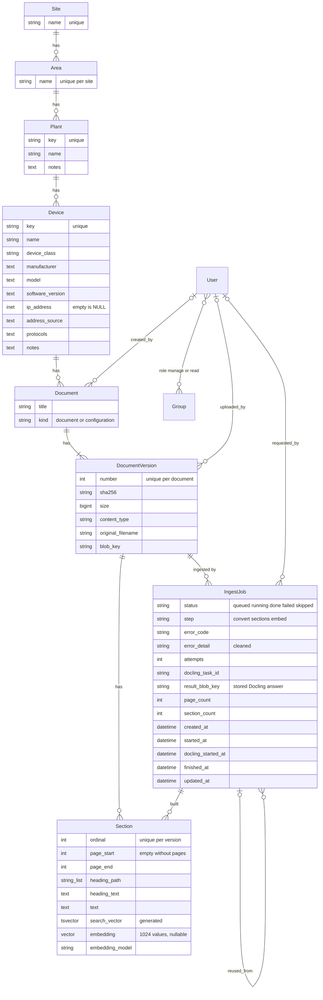
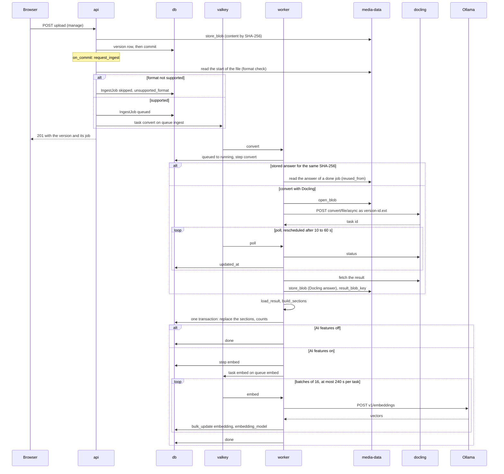
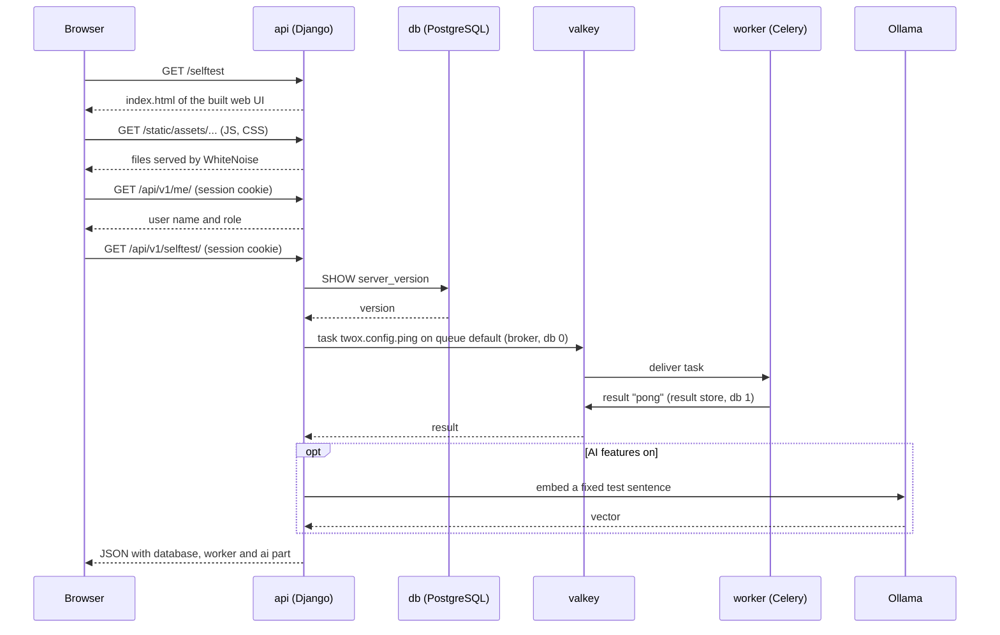

# Architecture

This document describes 2x as it exists on `main` after milestone M2 (ingestion and search): containers, repository layout, the Django apps and their data model, the file storage, the ingestion with Docling and the optional embeddings, the search, sign-in and roles, the change log, the API, how the web UI is served and translated, the configuration and the quality tools.
Features that do not exist yet (answers with sources, profiles, configuration files) are only mentioned where the code already reserves a place for them; their order is in [ROADMAP.md](ROADMAP.md) (in German).
How to start and use 2x is in the [README](../README.md). Known limits are collected at the end, under [Limits and known gaps](#limits-and-known-gaps).

Versions are not repeated here. They are pinned in `backend/uv.lock`, `web/package-lock.json`, `backend/Dockerfile`, `web/Dockerfile` and the compose files under `deploy/compose/`.
Decisions and their reasons (numbered E-01, E-02, ...) are recorded in [DECISIONS.md](DECISIONS.md), in German.

## Containers

```mermaid
flowchart LR
  browser["Browser on the host"]
  ollama["Ollama on the host (optional, AI features)"]
  subgraph default["network: default"]
    api["api<br/>Django + DRF, uvicorn<br/>serves the web UI and the admin"]
    worker["worker<br/>Celery, 4 processes"]
    db[("db<br/>PostgreSQL + pgvector, pg_trgm")]
    valkey[("valkey<br/>broker, result store, cache")]
    migrate["migrate<br/>runs once"]
    media[("volume media-data<br/>uploads and Docling answers")]
  end
  subgraph internal["network: docling-internal (internal, no internet)"]
    docling["docling<br/>docling-serve, CPU"]
  end
  browser -- "127.0.0.1:8000" --> api
  api --> db
  api --> valkey
  api --> media
  worker --> db
  worker --> valkey
  worker --> media
  migrate --> db
  worker -- "convert, poll, fetch" --> docling
  api -. "check_docling" .-> docling
  worker -. "embeddings" .-> ollama
  api -. "query embeddings, check_llm, self-test" .-> ollama
```

| Service | Image | Task in M2 |
| --- | --- | --- |
| `api` | `backend/Dockerfile`, target `runtime` | Django with Django REST Framework under uvicorn (ASGI). Serves the API below `/api/v1/`, the sign-in API of django-allauth below `/_allauth/`, the Django admin below `/admin/`, the built web UI for every other page path and its files below `/static/`. Starts the ingestion after an upload, runs the search (and embeds search queries with the AI features on). Mounts the volume `media-data` at `/data/media`. The only service with a host port: `127.0.0.1:${TWOX_API_PORT}` to container port 8000. |
| `worker` | same image as `api` | Celery worker that consumes every queue of the settings: `ingest`, `default` and, with the AI features on, `embed` (see [Task queues](#task-queues)). Sends files to Docling, polls, stores the answers, builds the sections and embeds them. Mounts `media-data` as well. Its health check pings exactly this worker through the broker. |
| `migrate` | same image as `api` | Applies the database migrations and exits. A separate service, so that several API instances never migrate at the same time; `api` and `worker` wait until it has completed successfully. |
| `db` | `pgvector/pgvector` | PostgreSQL with the extensions `vector` (pgvector) and `pg_trgm`, created by the migration `ingest.0001_extensions`. Data in the volume `db-data`: accounts and sessions, the structure, files and versions (metadata only), ingest jobs and sections with their search vectors and embeddings, the change log. |
| `valkey` | `valkey/valkey` | Redis-compatible store: Celery broker (database 0), Celery result store (database 1) and Django cache (database 2), which holds the counters of the sign-in rate limit. Data in the volume `valkey-data`. No host port. |
| `docling` | `docling-serve-cpu` from quay.io, pinned by tag and digest | Document conversion service (decisions E-30 to E-32). Converts every ingested document into a DoclingDocument (JSON). No host port, no volume: the models ship in the image. |

Ollama is not a container. It runs on the host, and `api` and `worker` reach it through `host.docker.internal` (`extra_hosts: host.docker.internal:host-gateway`).
It is used only with the AI features on (`TWOX_AI_ENABLED`, decision E-59): `worker` embeds the sections, `api` embeds search queries and runs the AI part of the self-test. With them off nothing contacts it, and `check_llm` prints `DISABLED:`.

`api`, `worker` and `migrate` run as the non-root user `twox` (UID 10001) of the backend image; `docling` runs as the non-root user its image defines.
`/app` in the runtime image belongs to root and is read-only for `twox`; the only place `twox` writes to is `/data/media`.
`api`, `worker`, `db`, `valkey` and `docling` have health checks, so `docker compose up -d --wait` returns only when they are healthy.
`api` and `worker` do not depend on `docling`: they start while Docling is still starting or when it is missing; ingest jobs then retry and fail visibly (`docling_unavailable`).
The `worker` gets `REMAP_SIGTERM: SIGQUIT` and `stop_grace_period: 90s`, so that `docker stop` starts Celery's cold shutdown with a soft phase of 60 s (see [Task queues](#task-queues)).

### Networks

- `default`: all services except `docling`. It has a route to the outside, which `api` and `worker` need to reach Ollama on the host.
- `docling-internal`: marked `internal: true`, so it has no route to the internet. Only `docling`, `api` and `worker` are attached (decision E-32).
  Together with the telemetry switches in `deploy/compose/compose.yaml` this keeps docling-serve from downloading or sending anything.
  The development service `backend-dev` is deliberately not attached, so `check_docling` has to run in `api` or `worker`.

### Restrictions on Docling

- Only the OCR engine RapidOCR is allowed (decision E-31). The service rejects every other OCR preset with HTTP 422, including the default `auto`; the client (`twox/ingest/docling.py`) sends `ocr_preset: "rapidocr"` with every conversion. On PDFs with a text layer no OCR runs at all.
- Because the warm-up at boot would use `auto`, models are not loaded at boot (`DOCLING_SERVE_LOAD_MODELS_AT_BOOT=false`). Healthy therefore means "server and queue run"; the models load with the first conversion.
- Limits (decision E-55), set in `deploy/compose/compose.yaml`: files up to 200,000,000 bytes (equal to the upload limit), at most 2,000 pages, at most 7,200 s per document (`DOCLING_SERVE_MAX_DOCUMENT_TIMEOUT`), one local worker (`DOCLING_SERVE_ENG_LOC_NUM_WORKERS=1`): Docling converts one document after the other.
- The 2-hour limit stands in three places that have to agree: `DOCLING_SERVE_MAX_DOCUMENT_TIMEOUT` in `deploy/compose/compose.yaml`, `DEFAULT_DOCUMENT_TIMEOUT_SECONDS` in `twox/ingest/docling.py` (the client refuses larger values) and `TWOX_DOCLING_MAX_DOCUMENT_TIMEOUT_SECONDS` in `settings.py`. `TWOX_DOCLING_DOCUMENT_TIMEOUT_SECONDS` can only lower it.
- **Memory:** the service has no memory limit. Measured in work order 057: 6.6 GiB at the peak while converting a manual of 267 pages, 2.8 GiB idle. A limit (recommended `mem_limit: 8g`) is still open with a7; until the decision the service runs without one.

## Images

`backend/Dockerfile` is built with the repository root as context. The root `.dockerignore` is a positive list that admits only `backend/` and `web/` (and keeps compiled `.mo` files out).

| Stage | Purpose |
| --- | --- |
| `base`, `builder`, `runtime-deps` | Python base, uv, and the virtual environment in `/opt/venv` from `backend/uv.lock` (without development packages). |
| `dev` | Development and CI tooling (Ruff, mypy, pytest, pip-licenses) plus GNU gettext for `makemessages` and the tests. Runs as root so that writes into the bind-mounted source tree work. Used by `backend-dev`. No web UI. |
| `web-build` | Node stage: `npm ci`, `npm run build` of `web/`, then writes `THIRD-PARTY-NOTICES.txt` next to the build. The build fails if the list of runtime packages changes without the notice list. Nothing of Node reaches the runtime image. |
| `static` | Runs `collectstatic` once at build time, without a database: the web UI build and the files of the Django admin. |
| `locale-build` | Installs GNU gettext and compiles the translation catalogues (`compilemessages`); only the `.mo` files leave this stage. |
| `runtime` | Application, the collected static files and the compiled catalogues; no development tools, no Node, no gettext; user `twox`; the empty directory `/data/media` owned by `twox`. Starts uvicorn. Used by `api`, `worker` and `migrate`. |

`web/Dockerfile` has a single stage `dev` (Node) for the web tooling; it is used only by `web-dev`.

## Repository layout

```
backend/                 Django project (Python), Dockerfile, uv project
  twox/config/           settings, URLs, ASGI, Celery app, logging filter, self-test, health, admin site, web UI view
  twox/<app>/            the eight Django apps (see below)
  twox/search/probes/    probe list of evaluate_search (references to the test factory only)
  locale/                German translation catalogue (django.po; .mo files are never committed)
  tests/                 pytest tests, one folder per app plus config and acceptance; stand-ins for Docling and Ollama
  scripts/               licence check of the Python packages
web/                     web UI (React, TypeScript, Vite, Tailwind CSS)
  src/                   application code and Vitest tests
  src/pages/             one file per page (README.md there explains routes and data fetching)
  src/components/        frame, navigation guards, page loading, shared components, files, ingest state and change log
  src/locales/           translation catalogues de/en (README.md there)
  src/api/generated/     API client generated from the OpenAPI schema (checked in)
  openapi/               OpenAPI schema of the backend (checked in)
  e2e/                   Playwright tests (sign-in, structure, map, import, files, ingestion, search, change log,
                         languages, settings, self-test, acceptance of M1 and M2)
  scripts/               licence check of the npm packages
deploy/compose/          compose files and the Dockerfile of the test factory tools
testfactory/             test factory: manifest, fetch script, layout (devices.csv), test questions
testdata/klein/          small, freely licensed documents for automatic tests
docs/                    roadmap, decisions, status, this file, work orders
.github/workflows/       CI (ci.yml) and secret scan (secrets.yml)
compose.yaml             entry point for docker compose (includes deploy/compose/)
```

Not present yet: `deploy/helm` (later), `testfactory/generated/` (configurations produced with vendor software, milestone T2).
`testfactory/extern/` exists only on a developer's machine after running `fetch.py`; Git ignores it.

### Django apps

All apps live below `backend/twox/` and are installed in `backend/twox/config/settings.py`. Two of them are still empty placeholders that fix the structure for later milestones.

| App | Intended purpose | Content in M2 |
| --- | --- | --- |
| `config` | Project package (not an app): settings, URLs, ASGI, Celery application. | Settings (with `check_ingest_timing`), `urls.py`, `asgi.py` (with the upload limit), `celery.py`, the task `ping` (`tasks.py`), the queue access (`taskqueue.py`), the access log filter (`logging.py`), the views for health, self-test and the web UI, the admin site for superusers (`admin_site.py`). |
| `assets` | Structure of the company: site, area, plant, device. | Models `Site`, `Area`, `Plant`, `Device`; API (`/api/v1/sites/`, `areas/`, `plants/`, `devices/`); admin; CSV import of the device list (`csv_import.py`, endpoint `/api/v1/imports/devices/`, command `import_devices`). |
| `files` | Documents and configuration files with versions and storage. | Models `Document`, `DocumentVersion`; the blob storage interface (`storage.py`); upload services with checksum, duplicates and version numbers, which start the ingestion after the commit (`services.py`); upload limit (`uploads.py`); safe downloads (`downloads.py`); API with the field `ingest` per version; read-only admin; command `remove_stale_uploads`. |
| `accounts` | Sign-in, roles, change log. | Custom user model `accounts.User` (an unchanged subclass of Django's `AbstractUser`); the roles and their DRF permission classes (`roles.py`, `permissions.py`); the allauth adapter (`adapter.py`); `/api/v1/me/`; the change log (`audit.py`, `/api/v1/audit-log/`, read-only admin); command `create_account`. |
| `ingest` | Import jobs, the connection to Docling, text sections. | Models `IngestJob`, `Section` and the migrations of the extensions; Docling client (`docling.py`); format check (`formats.py`); starting a job (`services.py`); the steps convert, poll, sections and embed (`pipeline.py`) and their Celery tasks (`tasks.py`); building sections from the DoclingDocument (`sections.py`); system check of the embedding length (`checks.py`); API (`api.py`); read-only admin; commands `check_docling`, `ingest_versions`, `embed_sections`. |
| `answers` | Answers with sources, connection to the language model. | Embedding client for an OpenAI-compatible model service (`embeddings.py`, protocol `Embedder`); command `check_llm` (with `--embed`). Answers follow in M3. |
| `search` | Search interface and its PostgreSQL implementation (full text, trigrams, vectors). | Interface (`interface.py`: `SearchRequest`, `SearchHit`, `SearchResult`, `get_search_backend()`); recognition of identifiers (`identifiers.py`); keyword, exact and vector search with fusion (`postgres.py`); API `/api/v1/search/` (`api.py`); measurement (`evaluation.py`, command `evaluate_search`, probe list `probes/m2.json`). |
| `profiles` | Device profile with proposed and confirmed fields. | empty |
| `importers` | Plugin interface (entry points) and the bundled importers for vendor formats. | empty. In M2 the formats are fixed in `ingest/formats.py` and every document goes to Docling; the plugin interface follows with the first importer for configuration files in M5 (work order 049, question 2). The CSV import of the device list lives in `assets`, because it reads no vendor format. |

## Data model



- **Structure** (decision E-41, `twox/assets/models.py`): `Site` and `Area` have a name, `Plant` and `Device` a key and a name. A key consists of lower-case letters, digits and `-` (at most 64 characters, checked by `full_clean()`), and is unique among all plants or among all devices. The device fields are the columns of `testfactory/layout/devices.csv` one to one as free text; only `ip_address` is checked (IPv4 or IPv6, empty is `NULL`), and `device_class` is one of seven values (E-53). All four have `created_at` and `updated_at`.
- **Files** (decision E-42, `twox/files/models.py`): a `Document` belongs to a device and has a title, a kind (`document` or `configuration`, checked by a database constraint), `created_at` and `created_by`. Each upload of it is a `DocumentVersion` with a number counted from 1, the SHA-256 checksum, size, content type, the cleaned original file name, `uploaded_by`, `created_at` and the key of its content in the blob storage. The content itself is not in the database.
  A version is immutable: `save()` on an existing version raises `VersionImmutableError`.
- **Ingest jobs** (decision E-55, `twox/ingest/models.py`): one row per attempt, never overwritten; the newest job of a version is its ingest state. At most one job per version is `queued` or `running` (partial unique constraint `ingest_job_one_active_per_version`); status, step and error code are checked by constraints. `error_code` is one of ten fixed kinds (`docling_unavailable`, `docling_rejected`, `conversion_failed`, `content_missing`, `unsupported_format`, `embedding_unavailable`, `embedding_rejected`, `embedding_dimension_mismatch`, `timeout`, `internal`), which the web UI translates; `error_detail` is a short technical text in English, cleaned of file names, paths, URLs and addresses (at most 2,000 characters). A conversion that Docling finished only in part (`partial_success`) ends `done`, with a note in `error_detail` that starts with `converted with ` (`PARTIAL_DETAIL_PREFIX`); the API shows it as `partly_converted`. `result_blob_key` points to the stored Docling answer; `reused_from` to the job whose answer was reused.
- **Sections** (`twox/ingest/models.py`): the searchable pieces of a version, built by the newest finished job and replaced as a whole when the version is ingested again. `page_start` and `page_end` are both set (1 ≤ start ≤ end) or both empty (Markdown has no pages). There are no line numbers (E-55; they follow with the importers of M5). `heading_text` joins `heading_path` with ` > `. `search_vector` is a generated column (`GeneratedField`): headings with weight A and text with weight B, each in the text search configurations `simple`, `german` and `english`. `embedding` is a pgvector column of 1024 values, empty without AI features; `embedding_model` names the model and is set exactly when there is an embedding (constraint).
- **Indexes on sections:** GIN on `search_vector`, GIN with `gin_trgm_ops` on `text` (exact identifiers), HNSW with `vector_cosine_ops` on `embedding`, and the unique B-tree on `(document_version, ordinal)`.
- **Accounts:** `accounts.User` is Django's user; a role is membership in one of the two groups `manage` or `read`, created by a data migration (decision E-40).
- **Deleting:** every foreign key uses `PROTECT`. An entry that still has children (an area with plants, a device with documents, a version with jobs or sections, a user with uploads or jobs) cannot be deleted. Only a superuser deletes, and only structure entries in the admin.
- **Change log:** the table `auditlog_logentry` of django-auditlog (see [Change log](#change-log)). Ingest jobs and sections are not logged (E-55): they are machine data, and a job records who started it and when.
- **Sessions** are stored in the database (`django_session`); allauth adds its tables for email addresses, which stay unused.

## File storage

All file content goes through the interface in `twox/files/storage.py` (decision E-42); no other code touches the files.

- `BlobStorage` is a protocol with three operations: `store_blob(stream) -> StoredBlob` (key, SHA-256, size), `open_blob(key)` and `blob_exists(key)`. There is no delete and no URL. `get_blob_storage()` returns the configured implementation.
- **Content-addressed:** the key is derived from the SHA-256 of the bytes, `sha256/ab/cd/<sha256>`. The same content is stored once, however often it is uploaded; a stored name never depends on device or file names. Keys are checked strictly before any file system access.
- **Atomic:** `FileSystemBlobStorage` writes to a temporary file `upload-*.part` below `<TWOX_MEDIA_ROOT>/tmp/` in blocks of 1 MiB, computes checksum and size on the way, calls `fsync`, makes the file read-only (`0440`) and only then links it under its key with `os.link`, which never replaces an existing file. Of two writers of the same content exactly one creates the entry. A failed or aborted write removes the temporary file.
- **Where:** the volume `media-data`, mounted at `/data/media` in `api` and `worker` (`TWOX_MEDIA_ROOT`). An implementation for S3-compatible storage can be added later behind the same interface without changes elsewhere.
- **Docling answers** are stored in the same storage (E-55, `IngestJob.result_blob_key`): the JSON of every finished conversion, as it came from Docling. It allows building the sections again (for example with another section size) and reusing a conversion for the same content without Docling. Measured in 057: 23.6 MiB for 14 distinct manuals with 1,159 pages.
- **Services** (`twox/files/services.py`): `create_document` and `add_version` check kind and size, store the content, lock the document, count the version number and save the rows in one transaction. Content equal to the newest version of the same file is refused (HTTP 409 in the API); equal content elsewhere is accepted and reported as a duplicate with device, file and version. File names lose path parts and control characters; a content type that is missing or invalid becomes `application/octet-stream`. For a document of the kind `document` both register `transaction.on_commit` to start the ingestion; a failure there is logged and never fails the upload.
- **Upload limit** (`twox/files/uploads.py`, `TWOX_UPLOAD_MAX_BYTES`): Django's ASGI handler reads a whole request body into a temporary file before any view runs. A wrapper around the ASGI application (`twox/config/asgi.py`) therefore refuses a body above the limit plus 64 KiB for the form fields with HTTP 413 before Django reads it, also when the body comes without a length. The upload views check `Content-Length` again, count the file bytes while Django parses them, and the services check the size once more.
- **Downloads** (`twox/files/downloads.py`) are always attachments, streamed in blocks of 64 KiB, with `X-Content-Type-Options: nosniff`, `Content-Security-Policy: sandbox` and a content type from an allow-list (PDF, Office, OpenDocument, Markdown, plain text, raster images without SVG); anything else is sent as `application/octet-stream`.
- **Configurations:** the kind `configuration` exists in the model, but the services refuse it until redaction of credentials arrives in milestone M5 (guideline 5, decision E-42).

## Ingestion

Every version of a document goes through the same path (work orders 041 to 049). The steps run in the worker; the API only starts them.



- **Start** (`twox/ingest/services.py`, `request_ingest`): only versions of the kind `document`; a configuration raises `IngestNotAllowedError` (API: 400 `configuration_not_ingested`), an active job `IngestAlreadyActiveError` (API: 409 `ingest_active`). The task is sent after the commit with `ignore_result=True` and two quick retries, so a missing Valkey delays an upload by about 8 seconds instead of minutes; the job then stays `queued` (with a warning in the log) until `ingest_versions --stuck` starts it again.
- **Format check** (`twox/ingest/formats.py`, E-57): extension of the original name **and** content must match. PDF: `%PDF-` at the very start. DOCX, XLSX, PPTX: a ZIP file whose table of contents has `[Content_Types].xml` (nothing is unpacked). Markdown: only `.md`, the whole content valid UTF-8 without NUL. PNG, JPEG, TIFF, BMP, WEBP: their signatures. The content type the browser reports is never read. Everything else is `skipped`/`unsupported_format` with a short reason; a missing content is `failed`/`content_missing`.
- **Convert and poll** (`pipeline.py`, tasks `twox.ingest.convert` and `twox.ingest.poll`): `convert` takes over a job only from `queued` (conditional `UPDATE`). It reuses the stored answer of the newest other job with the same SHA-256 that is `done` and was not a partial conversion; otherwise it uploads the file in a stream (chunked, blocks of 1 MiB) under the neutral name `version-<id><extension>` with `document_timeout = TWOX_DOCLING_DOCUMENT_TIMEOUT_SECONDS`. `poll` asks once and plans itself again after a quarter of the job's run time, between `TWOX_INGEST_POLL_MIN_SECONDS` and `..._MAX_SECONDS`. Every query writes `updated_at`. The deadline `TWOX_INGEST_TIMEOUT_SECONDS` counts from the first `started` at Docling, not from the wait in Docling's queue; a task that Docling never starts ends after `TWOX_DOCLING_QUEUE_TIMEOUT_SECONDS` from the start of the job. The answer is fetched into a temporary file and stored at once, before it is read.
- **Sections** (`sections.py`, `build_sections`): a pure function over the DoclingDocument JSON (schema 1.x). Reading order of `body`; headings form the path (`title` level 0, `section_header` its level) and start a new section; page headers and footers (`furniture`, `background`) are left out; captions and footnotes stay; tables become one line per row with cells joined by ` | `. Pieces are filled up to `TWOX_SECTION_MAX_CHARS` (default 2,000) and split at line breaks, then sentence ends, then white space, never inside a word or an address. Pages are the smallest and largest `prov.page_no` of the elements; a paragraph across two pages gives both pages to every piece of it. Control characters, lone surrogates and invisible characters are removed.
- **Embed** (`twox.ingest.embed`, only with the AI features on): first the dimension of the model setting is compared with the column (`embedding_dimension_mismatch` before any model call). Then embeddings of the same content are taken over (another version with the same SHA-256 and a section with the same ordinal, headings and text, embedded with the same model). The rest is sent in batches of `TWOX_EMBED_BATCH_SIZE`; the embedded text is the heading path, an empty line and the text. A task stops after `TWOX_EMBED_TASK_MAX_SECONDS`, or earlier when the soft time limit of the task is closer than `TWOX_EMBED_TIMEOUT_SECONDS`, and continues in a new task. Finished batches stay when a later one fails.
- **Errors:** temporary errors (Docling or the model service not reachable, a lost Docling task) are retried after 10, 20, 40, 60 and 60 s (doubling from the poll minimum up to the maximum); one counter `attempts` per job counts all retries and redeliveries, up to `TWOX_INGEST_MAX_RETRIES`. A refusal by Docling (`docling_rejected`), a failed conversion or an unreadable answer (`conversion_failed`), a refused model (`embedding_rejected`, the detail names `ollama pull <model>`) end the job at once. The soft time limit of a task gives `timeout`; anything unexpected `internal` with a fixed text, details only in the server log. A redelivered message (worker stopped, process lost) counts as an attempt.
- **Tasks** use `acks_late=True` and `reject_on_worker_lost=True`: a message comes back into the queue when its worker dies. Every step is idempotent: a second message for a finished or running job does nothing (`ignored`).
- **AI features off** (E-59): a job ends `done` after the sections; there is no step `embed`, no queue `embed`, and nothing contacts Ollama. The keyword search finds the sections at once.
- **Commands:** `ingest_versions` (`--missing`, `--failed`, `--stuck MINUTES`, `--all`, `--version ID`; dry run unless `--commit`; `--user` with the role `manage`) and `embed_sections` (`--missing`, `--all`). Both create jobs like the API. A job of `embed_sections` takes over `page_count` and the note on a partial conversion from the newest finished conversion of the version (061), so the ingest state of the version stays right. The README describes both: [Starting and repeating ingestion](../README.md#starting-and-repeating-ingestion).
- **System check** (`checks.py`): `twox.ingest.E001` stops `migrate` and every command when `TWOX_EMBED_DIMENSIONS` does not match the column and the AI features are on; with them off it is only the warning `twox.ingest.W001`.

### Measured run times (work order 057)

Development machine, CPU only, Docker VM with 15.5 GiB and 16 CPUs, `bge-m3`, sections of 2,000 characters; partly under parallel load of other containers.

| What | Value |
| --- | --- |
| Docling, vendor manuals of the test factory (9 PDFs, 7 to 267 pages) | 0.65 to 1.7 s per page; the largest manual (255 pages) 283.5 s |
| Docling, BetrSichV from `testdata/klein/` (60 pages) | 4.3 s per page, 258 s |
| Docling, Markdown | 0.0 to 0.2 s per file |
| Peak memory | `docling` 6.6 GiB (manual of 267 pages), 2.8 GiB idle; `worker` 590 MiB |
| Embedding with `bge-m3`, model loaded | about 1.25 s per 100 sections (1.66 to 3.8 s per 100 inside the jobs, with writing and parallel load) |
| Embedding taken over for the same content | 140 sections in 0.12 s (048) |
| Table `ingest_section`, freshly written | 49 MB for 2,623 sections, about 19 kB per section (HNSW 19 MB, data 3.3 MB, trigram 5.9 MB, GIN 3.4 MB) |
| Whole test factory (21 versions, 1,099 new pages) | 21 min 18 s from start to the last `done` |

At 0.65 to 1.7 s per page a document of 2,000 pages needs 0.4 to 0.9 hours; only a document as slow as the BetrSichV (4.3 s per page) would pass the limit of 2 hours and fail with `timeout`. Which embedding model is the default and whether Docling gets a memory limit are still open with a7 after this measurement; until the decision `bge-m3`, sections of 2,000 characters, the 2-hour limit and no memory limit stay as they are.

## Search

All search goes through the interface in `twox/search/interface.py` (`get_search_backend()`); the API, `evaluate_search` and later the answers of M3 use it. The only implementation is `PostgresSearchBackend` in `twox/search/postgres.py`; its module docstring holds every rule in detail.

- **What is searched** (E-57): per document of the kind `document`, the sections of the newest version that has sections. The state of the last job does not matter, so a document stays findable while it is ingested again or after embedding failed. When the document has a newer version without sections, the place says `is_latest: false` ("Older version" in the UI). Filters `device` and `plant` restrict all ways of finding.
- **Keyword:** `websearch_to_tsquery` in the configurations `simple`, `german` and `english`, joined with OR, on the GIN index of `search_vector`. `simple` keeps words and numbers as typed, the languages find word forms. `-word` excludes, `"…"` is a phrase. A phrase is checked again per configuration, so it does not match across the seam of the joined vectors, nor from the headings into the text.
- **Exact identifiers** (`identifiers.py`): IPv4 and IPv6 addresses (optional prefix), MAC addresses and words of ASCII letters and digits with at least one digit (`PLC-01`, `E1234`, `S7-1200`, `3.5`) are searched with a case-insensitive regular expression with word bounds over the trigram index: `192.168.0.5` finds `IP:192.168.0.5` and `192.168.0.5/24`, but not `192.168.0.50` or `10.192.168.0.5`. Pure numbers stay with the full-text search. At most 10 identifiers per query; only the text is searched, not the headings.
- **Vector** (AI features only): the query is embedded (`get_query_embedder()`, with `TWOX_EMBED_QUERY_PREFIX` and the short time limit `TWOX_SEARCH_EMBED_TIMEOUT_SECONDS`; the model list of Ollama is checked once per process and cached for 300 s). The 50 nearest sections by cosine distance take part, only those embedded with the current model. The HNSW index is searched with `hnsw.iterative_scan = relaxed_order` and `hnsw.ef_search = 100`, set for the transaction of the query only, so a filter does not leave the list short.
- **Fusion:** Reciprocal Rank Fusion with k = 60: a section gets `1/(60 + rank)` for every list it is in; equal values share a rank. How exact hits count depends on the query (063):
  - **Identifier query** (at least one identifier and at most one other word, such as `192.168.0.5` or `Fehler E1234`) **or no vector list** (AI features off, model service failed, nothing embedded): the number of identifiers found is added to the fused part, which stays below 1, so exact hits always come first.
  - **Any other query with a vector list** (a question): the exact hits are a third list of the fusion, ranked by the number of identifiers found, then by keyword rank; ties share the mean of their places. At equal score the hit nearer in meaning comes first. So a question that names a product no longer puts every section that merely mentions the product above the sections that answer it.
- **Exclusions** (`-word`) apply to every way of finding: the negated parts of the parsed query are checked on every candidate; the vector search leaves such sections out before it takes the nearest 50.
- **Same content** (E-55): sections with the same checksum of the version, the same pages (without pages, the same headings) and the same text are one hit with all places (document, version with file name, device, plant), after the fusion.
- **Snippet:** at most 300 characters of plain text around the first found place, with the found places as `highlights` in Unicode code points. Pure vector hits have no highlights.
- **Fallback without a model:** with the AI features off the model service is never asked (`semantic: disabled`). When it fails (not reachable, slower than the time limit, model refused, a cloud model, wrong vector length) the search falls back to keyword and exact (`semantic: unavailable`) and logs the kind of error, never the query.
- **Measurement:** `evaluate_search` measures rank, Recall@5, Recall@10 and MRR of keyword, vector and combined search against a probe list (`twox/search/probes/m2.json`, 7 probes that point to pages of the test factory manuals by manifest id and checksum). With all manuals of the test factory ingested (test environment, `bge-m3`, sections of 2,000 characters) the combined search reached Recall@5 0.429 and MRR 0.144 after work order 063 (before: 0.286 and 0.095); the vector search alone Recall@5 0.429 and MRR 0.350 (057).

## Sign-in and sessions

- **django-allauth, headless** (decision E-38): allauth renders no pages. The web UI has its own sign-in page `/login` and talks to allauth's browser API at the same origin: `POST /_allauth/browser/v1/auth/login` (user name and password), `GET` and `DELETE /_allauth/browser/v1/auth/session`, `GET /_allauth/browser/v1/config`. Only the client `browser` is enabled. These endpoints are not part of the OpenAPI schema; the UI calls them through `web/src/api/auth.ts`.
- **Session and CSRF:** after sign-in the browser holds Django's session cookie (`HttpOnly`, `SameSite=Lax`, 8 hours); the session is stored in the database. Every page of the UI sets the cookie `csrftoken`, and every writing request sends its value in the header `X-CSRFToken`. DRF uses `SessionAuthentication` only; there is no token and no HTTP basic authentication.
- **Closed endpoints:** there is no self-registration (`AccountAdapter.is_open_for_signup` is false), no email and no self-service for passwords or email addresses. The allauth endpoints for changing or resetting a password and for email addresses answer 404 (`CLOSED_ALLAUTH_PATH` in `twox/config/urls.py`). `/accounts/` is included for the callback URLs of OpenID Connect later and registers no path today.
- **Passwords:** at least 12 characters and Django's three other standard validators.
- **Rate limit:** `ACCOUNT_RATE_LIMITS` in the settings: failed sign-ins 10 per minute per IP address and 5 per 5 minutes per account, sign-in attempts 30 per minute per IP address. allauth counts in Django's cache, which is `RedisCache` on Valkey database 2 (`TWOX_CACHE_URL`), so all API processes share the counters and a restart does not reset them. A locked account gets HTTP 400 with `too_many_login_attempts`, the per-IP limit HTTP 429. The adapter logs failed and blocked sign-ins with the user name only.
- **Admin:** `twox/config/admin_site.py` lets only active superusers in and replaces the admin's sign-in form: `/admin/login/` redirects anonymous visitors to `/login?next=/admin/...` (only paths below `/admin/` are accepted as `next`) and never signs anyone in. A signed-in account without access gets 403.
- **Accounts on the command line:** `create_account <name> --role manage|read [--update]` reads the password from `TWOX_ACCOUNT_PASSWORD` or asks twice in a terminal; it never sets `is_staff` or `is_superuser`. Superusers come from Django's `createsuperuser`.

## Roles and API permissions

- Two roles (decision E-40): `read` and `manage`, as Django groups. `user_role()` in `twox/accounts/roles.py` gives `None` for anonymous, inactive and role-less users, `manage` for superusers and for members of both groups.
- Three DRF permission classes in `twox/accounts/permissions.py`: `CanRead` (any method, any role), `CanManageOrReadOnly` (reading for both roles, writing for `manage`), `CanManage` (only `manage`). All three answer 403 to anonymous and role-less requests.
- **Closed by default:** `DEFAULT_PERMISSION_CLASSES` is `CanRead`, so a view without its own class needs a role. The test `backend/tests/config/test_api.py` walks through every URL below `/api/v1/`, calls it with every method as anonymous and as a role-less user and fails if anything other than the listed exceptions answers with something other than 403. Exceptions: `OPEN_PATHS` = `/api/v1/health/` (anonymous, for the container health check) and `ROLELESS_PATHS` = `/api/v1/me/` (any signed-in user); another test checks that each exception is still needed.
- **No rights per device** (E-40): a role reads and searches all devices.

| Endpoint | Methods | Permission |
| --- | --- | --- |
| `/api/v1/health/` | GET | open |
| `/api/v1/me/` | GET: user name, role, superuser flag | signed in |
| `/api/v1/selftest/` | GET: parts `database`, `worker` and `ai` | `CanRead` |
| `/api/v1/sites/`, `areas/`, `plants/`, `devices/` and `{id}/` | GET list and detail; POST, PUT, PATCH; no DELETE (405) | `CanManageOrReadOnly` |
| `/api/v1/imports/devices/` | POST `multipart/form-data` with `file` and `dry_run` (default true); always 200 with a report, 400 only for an invalid form, 413 above the upload limit | `CanManage` |
| `/api/v1/devices/{device_id}/documents/` | GET the files of a device; POST a new file (`file`, `title`, `kind`) | `CanManageOrReadOnly` |
| `/api/v1/documents/{document_id}/` | GET a file with all versions | `CanRead` |
| `/api/v1/documents/{document_id}/versions/` | POST a new version; 409 for content equal to the newest version | `CanManageOrReadOnly` |
| `/api/v1/document-versions/{version_id}/download/` | GET the content as attachment | `CanRead` |
| `/api/v1/document-versions/{version_id}/ingest/` | POST without body: start ingesting the version again; 202 with the new job (also when it is skipped at once or its content is missing), 409 `ingest_active` with the active job while a job is queued or running, 400 `configuration_not_ingested`, 404 | `CanManage` |
| `/api/v1/ingest-jobs/` | GET, 50 jobs per page, newest first, with document, version (with file name) and device; filters `status` (repeatable), `device`, `document`, `version` and `latest` (only the newest job of each version, chosen before the other filters); every row has `is_latest`; `requested_by` only for `manage`, `null` for `read` and for jobs of the system | `CanRead` |
| `/api/v1/search/` | GET with `q` (required, 1 to 500 characters after trimming), `device` and `plant` (ids, each repeatable, at most 100), `limit` (1 to 50, default 20); 400 with the error at the parameter. Answer: `semantic` (`used`, `disabled` or `unavailable`) and `hits` with `section_id`, `score`, `match_kinds` (`exact`, `keyword`, `semantic`), `snippet`, `highlights` (`start`, `end` in Unicode code points), `page_start`, `page_end`, `heading_path` and `locations` (document, version with `original_filename` and `is_latest`, device, plant) | `CanRead` |
| `/api/v1/audit-log/` | GET, 50 entries per page, newest first; filters `object_type`, `object_id`, `actor` | `CanManage` |

Every version in the files endpoints carries `ingest`: its newest ingest job (status, step, error code, cleaned error detail, `partly_converted`, counts, times) or `null`, loaded with one extra query for the whole answer. The newest job may be an embedding job of `embed_sections`; it carries the page count and the note on a partial conversion of the conversion before it. Error code and error detail are shown to both roles; who started a job (`requested_by`) only to `manage` (E-57).

The lists of areas, plants and devices filter by their parents (`areas?site=`, `plants?area=`, `devices?plant=`, `devices?site=`). Two requests that create the same key at the same moment end with one success and one HTTP 400 at the field: the views turn the violated unique constraint into a field error.

## Change log

- **django-auditlog** (decision E-43), registered in `twox/accounts/audit.py`: `Site`, `Area`, `Plant`, `Device`, `Document`, `DocumentVersion` with all their own columns, and `User` without `password` and `last_login`, with its groups (role changes). Creating, changing and deleting each write one entry with time, action, object, actor and the changed fields as `[old, new]` JSON values (`AUDITLOG_STORE_JSON_CHANGES`). A role change writes two entries (old group removed, new group added). `IngestJob` and `Section` are not registered (E-55).
- **Actor:** during a request `AuditMiddleware` names the signed-in user. It is auditlog's middleware without any value from the request: no IP address (`AUDITLOG_DISABLE_REMOTE_ADDR`), no port from `X-Forwarded-Port`, no correlation id (`AUDITLOG_CID_HEADER = None`). Such client values could otherwise make writing the entry fail after the change was saved. Outside a request (the import command) the code wraps its work in `acting_as(user)`.
- **Reading:** `/api/v1/audit-log/` for `manage`; the page `/audit` and, on the file page, the entries of that file (component `AuditTrail`). In the admin the entries are read-only for superusers (no add, change or delete).
- **Writing:** only through `save()` and `delete()` of the registered models; there is no API to write or delete entries. The limits are listed under [Limits and known gaps](#limits-and-known-gaps).

## Serving the web UI

- Django serves the web UI itself; there is no Node server at runtime. Vite builds it with the base path `/static/`, the image build copies it into Django's static files, and WhiteNoise serves them below `/static/` (files below `/static/assets/` carry a content hash and are cached as immutable).
- **Every page path is the UI** (decision E-39): `/` and every path whose first segment is not `api`, `static`, `admin`, `_allauth` or `accounts` get the same `index.html` (`web_index` in `backend/twox/config/webui.py`, pattern `WEB_UI_PATH` in `urls.py`), with `Cache-Control: no-cache` and the CSRF cookie. So `/devices/7` can be opened directly or reloaded. Only GET and HEAD are allowed there. An unknown path below one of the five reserved segments stays a 404 from Django; an unknown page path is answered by the UI with its "not found" page. `/favicon.ico`, `/favicon.svg` and `/apple-touch-icon.png` are served from fixed paths (`ROOT_FILES` in `webui.py`).
- **Routes** (`web/src/routes.tsx`, react-router in data mode): `/` structure, `/map`, `/search`, `/ingest`, `/devices/:deviceId`, `/documents/:documentId`, `/import`, `/audit`, `/selftest`, `/settings`, `/login`. Every page except `/login` requires a session (otherwise the UI goes to `/login?next=...` and back after signing in; `next` accepts only paths of this application) and a role (`web/src/navigation.ts`: `/import` and `/audit` need `manage`, the others `read`). A missing role shows "no permission" without a redirect. Details: [web/src/pages/README.md](../web/src/pages/README.md).
- **Loading on demand** (work order 062): only the sign-in page and the structure page are in the main bundle; every other page is loaded when it is opened (`lazyPage()` in `web/src/components/PageLoading.tsx`), with a calm loading state after 300 ms and a "Reload" notice when the code cannot be loaded (for example after a new build).
- **Data:** pages read and write through TanStack Query with the query and mutation options of the generated client. The sign-in state is one query on `/api/v1/me/`; a 403 from any other call makes the UI ask `me` again to tell an expired session from a missing permission. The file page, the device page and `/ingest` ask again every 5 seconds while a shown job is queued or running, and not otherwise.

## Translation

- **Web UI:** i18next with react-i18next. One JSON catalogue per language and namespace in `web/src/locales/<de|en>/`, bundled with the build (nothing is loaded over the network); TypeScript checks the keys against the English files. The first language comes from the stored choice or the browser, the switch in the header changes it. Details: [web/src/locales/README.md](../web/src/locales/README.md).
- **API:** Django's gettext. `LocaleMiddleware` picks German or English per request from `Accept-Language` (the UI sends the language it shows); without a match it answers in English. The German catalogue is `backend/locale/de/LC_MESSAGES/django.po`, regenerated with `makemessages -l de --add-location=file`; CI fails if it is out of date, and `pytest` fails while an entry is untranslated or fuzzy. The 413 answer of the ASGI wrapper is translated as well, although it is sent before Django runs.
- **Ingest errors** are stored as a fixed `error_code` and translated by the web UI, one message per kind; the technical `error_detail` stays English and untranslated.
- **Compiled catalogues** (`.mo`) are never committed (decision E-46). They exist only in the runtime image (built in the stage `locale-build`) and in the tests, which compile them into a temporary directory outside `/app`. GNU gettext (GPL) is a tool of the `dev` image and of `locale-build` only.

## Compose files

```
compose.yaml                         include: deploy/compose/compose.yaml
                                              deploy/compose/compose.web.yaml
deploy/compose/compose.yaml          db, valkey, migrate, api, worker, docling;
                                     backend-dev (profile dev); networks and volumes
deploy/compose/compose.web.yaml      web-dev (profile dev), e2e (profile e2e);
                                     volume web_node_modules
deploy/compose/compose.tools.yaml    gitleaks-dir, gitleaks-git (used with -f)
deploy/compose/testfactory.yaml      fetch, check, check-offline (used with -f)
```

- The root `compose.yaml` only includes the two files, so that plain `docker compose ...` works from the repository root and all services share one project and one network (the browser test reaches `api` that way).
- Paths in the files under `deploy/compose/` are relative to that folder. Values come from the `.env` file in the repository root; the compose file stops with "Copy .env.example to .env first" if a required value is missing.
- **Volumes:** `db-data`, `valkey-data`, `media-data` (uploaded files and Docling answers, `api` and `worker`) and `web_node_modules`.
- **Profiles:** services in a profile start only when the profile is given or the service is named. `dev` holds the tooling containers `backend-dev` (the `dev` image with `backend/` bind-mounted, `testfactory/layout/` mounted read-only at `/testfactory/layout` and `testfactory/manifest.yaml` and `questions.yaml` read-only below `/testfactory/` for the probe tests; depends on `db` only) and `web-dev` (`web/` bind-mounted, `node_modules` in a named volume). `e2e` holds the Playwright container, which uses the packages that `web-dev` installed in the shared volume and gets the test account from `TWOX_E2E_USERNAME` and `TWOX_E2E_PASSWORD` and the local part of the M2 acceptance test from `TWOX_M2_LOCAL`, `TWOX_M2_REQUIRED` and `TWOX_M2_FAILED_FILE`.
  Because of the profiles, a full clean-up needs `docker compose --profile dev --profile e2e down -v`.
- `compose.web.yaml` is also valid on its own; the CI job `web` runs it with `-f`.
- `compose.tools.yaml` and `testfactory.yaml` are not included. Their services run without network (`gitleaks-*`, `check-offline`) or only with what they need (`fetch` downloads vendor material).

## Path of a request: the self-test page

The self-test page proves that every layer works: browser, Django, database, broker, worker and back, and shows the state of the AI features.



1. **Web UI.** `GET /selftest` is answered by the view in `backend/twox/config/webui.py` with the `index.html` of the built UI (see [Serving the web UI](#serving-the-web-ui)). Without a session the UI goes to the sign-in page first.
2. **API call.** The page (`web/src/pages/SelftestPage.tsx`) calls `GET /api/v1/selftest/` through the generated client (relative URL, same origin as the page, with the session cookie). The wrapper `web/src/api/selftest.ts` turns network errors, a 15-second timeout, HTTP errors and malformed answers into distinct states the page can show. The endpoint needs a signed-in user with a role (`CanRead`); otherwise it answers 403 and sends no task.
3. **Database.** `backend/twox/config/selftest.py` reads `SHOW server_version` from PostgreSQL; no table is involved.
4. **Broker and worker.** The self-test calls `ping_worker()` in `backend/twox/config/taskqueue.py`, the one place where the API talks to the task queue for the self-test. It sends the task `twox.config.ping` to the queue `default` with one connection attempt, bounded socket timeouts and an expiry, and waits at most 5 seconds for the result. For the result store it uses an own Celery app with the same settings plus short socket timeouts and no retries; the app of the worker keeps Celery's defaults. The API first checks the result store and subscribes to the result, then sends the task. The worker returns `pong`; the API reads the result from the result store and then deletes it.
5. **AI features** (E-59). Off: the part `ai` is only `{"enabled": false}`, nothing is contacted, and the page shows a neutral card "Not enabled" without warning or error. On: the API compares the embedding length with the database column, then embeds a fixed sentence with a socket time limit of 4 s per request, and reports `ok`, `model`, `dimensions` and a cleaned `error`.
6. **Answer.** The view always answers HTTP 200 with a `database` part (`ok`, `server_version`, `error`), a `worker` part (`ok`, `result`, `duration_ms`, `error`) and the `ai` part. A failing part has `ok: false` and a short error text without addresses, credentials or tracebacks; details go to the server log only.

If the broker answers but the result store does not, the worker part reports `result store not reachable` after about 5 seconds.

## Task queues

Celery is configured in `backend/twox/config/settings.py` (prefix `CELERY_`) and `backend/twox/config/celery.py`. Valkey is addressed through Celery's Redis transport, hence `redis://` URLs (decision E-29). Messages and results are JSON only; nothing is unpickled.

| Queue | Tasks (route in `CELERY_TASK_ROUTES`) | Exists |
| --- | --- | --- |
| `ingest` | `twox.ingest.convert`, `twox.ingest.poll`: sending files to Docling, status queries, fetching, sections | always |
| `embed` | `twox.ingest.embed`: embeddings of the sections | only with the AI features on (`task_queues(ai_enabled=...)`) |
| `default` | everything without a route, for example the self-test task `twox.config.ping` | always |

- Each queue has its own direct exchange and routing key of the same name, so a message for one queue never reaches another.
- `task_create_missing_queues` is off: a misspelled queue name is an error, not a new queue nobody consumes. With the AI features off, sending `embed` therefore fails at once (`QueueNotFound`); the code checks the switch before that anyway.
- **One worker for all queues** (E-55): the service `worker` starts without `--queues` and consumes every queue of `CELERY_TASK_QUEUES`. Splitting it into one service per queue only needs a `--queues` list per service in `deploy/compose/compose.yaml`.
- **Concurrency 4, prefetch 1:** four processes (`--concurrency 4`), each reserving one message at a time (`CELERY_WORKER_PREFETCH_MULTIPLIER = 1`). The heavy work runs in Docling and Ollama; the tasks send, poll briefly and plan themselves again with a countdown.
- **Shutdown:** `docker stop` sends SIGTERM, which compose maps to SIGQUIT (`REMAP_SIGTERM`), Celery's cold shutdown. Running tasks get `CELERY_WORKER_SOFT_SHUTDOWN_TIMEOUT` (60 s) to finish, then they are cancelled; tasks with `acks_late` (all ingest tasks) go back into the queue at once, other running tasks are lost. `stop_grace_period: 90s` keeps Docker from killing the worker earlier.
- The CSV import runs synchronously in the request, not in the worker.

| Time | Value | Why |
| --- | --- | --- |
| `visibility_timeout` of the Redis transport (`TWOX_BROKER_VISIBILITY_TIMEOUT_SECONDS`) | 3,600 s | Celery's default, set explicitly. No task and no countdown may reach it, otherwise Valkey delivers the message twice |
| Hard time limit per task (`TWOX_TASK_TIME_LIMIT`, `CELERY_TASK_TIME_LIMIT`) | 360 s | the process is replaced |
| Soft time limit per task (`TWOX_TASK_SOFT_TIME_LIMIT`, `CELERY_TASK_SOFT_TIME_LIMIT`) | 300 s | 60 s before the hard limit: time to clean up (ingest job: `timeout`) |
| `TWOX_EMBED_TASK_MAX_SECONDS` | 240 s | an embedding task stops in time and continues in a new one; no new batch starts when less than `TWOX_EMBED_TIMEOUT_SECONDS` (120 s) remain before the soft limit |
| `CELERY_WORKER_SOFT_SHUTDOWN_TIMEOUT` | 60 s | running tasks finish on `docker stop` |
| `stop_grace_period` of `worker` | 90 s | longer than the soft shutdown |
| `TWOX_INGEST_POLL_MIN_SECONDS` / `_MAX_SECONDS` | 10 s / 60 s | quick feedback for short documents, at most one query a minute for long ones; also the range of the retry waits |
| `TWOX_DOCLING_DOCUMENT_TIMEOUT_SECONDS` | 7,200 s | 2 hours per document (E-55), equal to the limit of the Docling service; can only be lowered |
| `TWOX_INGEST_TIMEOUT_SECONDS` | 9,000 s | 2.5 hours from the start at Docling: 30 minutes more than Docling's own limit, so that Docling reports its error first; the wait in Docling's queue does not count here |
| `TWOX_DOCLING_QUEUE_TIMEOUT_SECONDS` | 86,400 s | 24 hours from the start of the job for a Docling task that never starts (stays `pending`); long, so that a large batch waiting in Docling's queue one document after another is not cut off (work order 065) |
| `TWOX_INGEST_MAX_RETRIES` | 5 | temporary errors (Docling or Ollama not reachable) and redeliveries |
| Self-test | 5 s worker, 4 s per AI request | the page waits at most 15 s |

**Start check** (`check_ingest_timing` at the end of `settings.py`): every value is a whole number greater than 0; `TWOX_DOCLING_DOCUMENT_TIMEOUT_SECONDS` ≤ 7,200; `TWOX_INGEST_TIMEOUT_SECONDS` > `TWOX_DOCLING_DOCUMENT_TIMEOUT_SECONDS`; `TWOX_DOCLING_QUEUE_TIMEOUT_SECONDS` ≥ `TWOX_INGEST_TIMEOUT_SECONDS`; poll minimum ≤ poll maximum < `visibility_timeout`; `TWOX_EMBED_TASK_MAX_SECONDS` < soft limit < hard limit < `visibility_timeout`. A violation raises `ImproperlyConfigured` with both names and values and stops `api`, `worker` and every `manage.py` command.

## API and the generated client

- **API.** Django REST Framework, JSON only (no browsable API); uploads use `multipart/form-data` in the views that take files. Permissions and endpoints: see [Roles and API permissions](#roles-and-api-permissions). There is no schema endpoint.
- **Schema.** drf-spectacular generates the OpenAPI description from the views and serializers with `python manage.py spectacular`. It is checked in as `web/openapi/schema.yml`. The allauth endpoints are not part of it.
- **Client.** `@hey-api/openapi-ts` (configured in `web/openapi-ts.config.ts`, run with `npm run api:generate`) generates types, SDK functions, a fetch client and, with its plugin `@tanstack/react-query`, query and mutation options per endpoint into `web/src/api/generated/`. The generated code is checked in and never edited by hand. The fetch client is copied in as source; the query options import the runtime package `@tanstack/react-query`.
- **Use.** The UI calls the API only through the generated client. `web/src/api/client.ts` adds `X-CSRFToken` to writing requests and `Accept-Language` to every request; `web/src/api/errors.ts` turns failures into an `ApiError`.
- **Kept in sync by CI.** The job `backend` regenerates the schema and fails if `web/openapi/` changes; the job `web` regenerates the client from the checked-in schema and fails if `web/openapi/` or `web/src/api/` changes. Together this covers backend, schema and client. Step-by-step instructions: [web/openapi/README.md](../web/openapi/README.md).

## Logging

- The project's loggers (`twox.*`) write to standard error at level INFO. They name jobs, versions and kinds of error, never the content of sections or search queries. The raw error text of Docling goes to this server log only; the job keeps the cleaned text.
- **Access log without query strings** (work order 052, E-57): uvicorn writes one line per request to the logger `uvicorn.access`, with the path and its query string. `LOGGING` in `settings.py` configures that logger with uvicorn's own formatter and the filter `DropQueryString` (`backend/twox/config/logging.py`), which cuts the query string off every line. Search texts (`/api/v1/search/?q=…`) and filters therefore never reach the access log. Method, path, status and the client address (`%(client_addr)s` of the formatter, address and port) stay in every line, also for failed sign-ins. Whether the client address is removed as well is open with a7 (sign-in and data protection); until then it is logged.
- Because Django configures logging after uvicorn did and replaces the handlers of that logger, uvicorn's switch `--no-access-log` no longer silences the access log. The `api` service does not use it; to switch the access log off, remove its handler in `LOGGING`.

## Configuration

Every deployment-specific value comes from an environment variable with the prefix `TWOX_` (the project name cannot start with a digit). Compose reads them from `.env` in the repository root, a copy of `.env.example`, and passes them to `migrate`, `api`, `worker` and `backend-dev`. `.env` is ignored by Git.

| Variable | Meaning | Value in `.env.example` | If unset or empty |
| --- | --- | --- | --- |
| `TWOX_SECRET_KEY` | Django secret key. | development-only value | required: compose stops |
| `TWOX_DEBUG` | Django debug mode (detailed error pages). Development only; leave empty or `false` everywhere else. | `true` | off |
| `TWOX_ALLOWED_HOSTS` | Comma-separated host names Django answers to. Must contain `localhost`, because the health check of `api` calls `http://localhost:8000/api/v1/health/`. | `localhost,127.0.0.1` | empty list: every request is rejected |
| `TWOX_API_PORT` | Host port of `api`, published on `127.0.0.1` only. | `8000` | `8000` |
| `TWOX_DB_HOST` | PostgreSQL host. | `db` | `db` |
| `TWOX_DB_PORT` | PostgreSQL port. | `5432` | `5432` |
| `TWOX_DB_NAME` | Database name; also creates the database in `db`. | `twox` | required: compose stops |
| `TWOX_DB_USER` | Database user; also creates the user in `db`. | `twox` | required: compose stops |
| `TWOX_DB_PASSWORD` | Database password; also set in `db`. | development-only value | required: compose stops |
| `TWOX_CELERY_BROKER_URL` | Celery broker (Valkey, database 0). | `redis://valkey:6379/0` | `redis://valkey:6379/0` |
| `TWOX_CELERY_RESULT_BACKEND` | Celery result store (Valkey, database 1). | `redis://valkey:6379/1` | `redis://valkey:6379/1` |
| `TWOX_CACHE_URL` | Django cache (Valkey, database 2), shared by all API processes; holds the counters of the sign-in rate limit. | `redis://valkey:6379/2` | `redis://valkey:6379/2` |
| `TWOX_MEDIA_ROOT` | Directory of the uploaded files and Docling answers inside `api` and `worker`; must be an absolute path. Compose mounts the volume `media-data` at `/data/media`, so the two have to match. | `/data/media` | `/data/media` |
| `TWOX_UPLOAD_MAX_BYTES` | Largest accepted upload in bytes (a whole number greater than 0). | `200000000` (200 MB, decimal) | `200000000` |
| `TWOX_LLM_BASE_URL` | OpenAI-compatible model server: embeddings, `check_llm`, the AI part of the self-test; answers later. | `http://host.docker.internal:11434/v1` | same |
| `TWOX_DOCLING_URL` | docling-serve; used by the ingestion and `check_docling`. | `http://docling:5001` | same |
| `TWOX_AI_ENABLED` | Optional AI features (E-59): embeddings, search by meaning. Off: nothing contacts the model service, no queue `embed`. | `true` | off |
| `TWOX_EMBED_MODEL` | Embedding model in Ollama (E-56). | `bge-m3` | `bge-m3` |
| `TWOX_EMBED_DIMENSIONS` | Vector length of the model; must match the column (1024), checked at start (`twox.ingest.E001`/`W001`). | `1024` | `1024` |
| `TWOX_EMBED_BATCH_SIZE` | Texts per embedding request. | `16` | `16` |
| `TWOX_EMBED_TIMEOUT_SECONDS` | Socket time limit of one embedding request while ingesting and in `check_llm --embed`. | `120` | `120` |
| `TWOX_SEARCH_EMBED_TIMEOUT_SECONDS` | Socket time limit for embedding a search query; after it the search falls back to keywords. | `20` | `20` |
| `TWOX_EMBED_QUERY_PREFIX` | Text put in front of search queries only (some models need an instruction); taken unchanged, spaces at the end included. | empty | empty |
| `TWOX_INGEST_MAX_RETRIES` | Retries after a temporary error before a job fails. | `5` | `5` |
| `TWOX_INGEST_POLL_MIN_SECONDS` | Shortest wait between two status queries at Docling (and first retry wait). | `10` | `10` |
| `TWOX_INGEST_POLL_MAX_SECONDS` | Longest wait between two status queries (and longest retry wait). | `60` | `60` |
| `TWOX_DOCLING_DOCUMENT_TIMEOUT_SECONDS` | `document_timeout` sent to Docling; at most 7,200. | `7200` | `7200` |
| `TWOX_INGEST_TIMEOUT_SECONDS` | Deadline of a conversion from its start at Docling; greater than the value above. | `9000` | `9000` |
| `TWOX_DOCLING_QUEUE_TIMEOUT_SECONDS` | Deadline of a job whose Docling task never starts, from the start of the job; at least the value above. | `86400` | `86400` |
| `TWOX_SECTION_MAX_CHARS` | Largest section in characters; a change takes effect with `ingest_versions --all`. | `2000` | `2000` |
| `TWOX_EMBED_TASK_MAX_SECONDS` | Longest run of one embedding task before it continues in a new one; below the soft time limit (300). | `240` | `240` |
| `TWOX_E2E_USERNAME`, `TWOX_E2E_PASSWORD` | Test account of the browser test. Passed only to the `e2e` container and used by the step "Create test account"; never use the values for a real account. | `e2e-manager`, a development-only password | the browser test cannot sign in |

`TWOX_UPLOAD_MAX_BYTES` and every number of the embedding and ingestion settings are checked at start (whole number greater than 0); an invalid value stops `api`, `worker` and `manage.py`. `check_ingest_timing` checks the ingestion values against each other (see [Task queues](#task-queues)).
`create_account` reads the password from `TWOX_ACCOUNT_PASSWORD` if it is set; it is not part of `.env` and is passed to the container as a variable name only.
`TWOX_M2_LOCAL`, `TWOX_M2_REQUIRED` and `TWOX_M2_FAILED_FILE` are read only by the `e2e` container for the local part of the M2 acceptance test (README, "Acceptance of M2 by hand"); they are not part of `.env`.
The image build and the browser test use two further variables internally (the path of the built web UI during `collectstatic` in `backend/Dockerfile`, and the address of `api` for Playwright in `deploy/compose/compose.web.yaml`). They have built-in defaults and are not part of `.env`.

## Quality tools

Everything runs in containers with the same commands locally and in CI. The exact commands are in the README and in `.github/workflows/ci.yml`.

| Area | Tool | Command (inside the container) |
| --- | --- | --- |
| Python lint and format | Ruff (settings in `backend/pyproject.toml`) | `ruff check .`, `ruff format --check .` |
| Python types | mypy in strict mode with the Django and DRF plugins | `mypy .` |
| Python tests | pytest with pytest-django, against the real PostgreSQL in `db`; Docling and Ollama replaced by stand-ins | `pytest` (skips the tests marked `worker`) |
| Worker round trip | pytest, marker `worker`; needs `valkey` and `worker` running | `pytest -m worker` |
| Translation catalogue | Django `makemessages` | `python manage.py makemessages -l de --add-location=file`, then `git diff --exit-code` |
| Migrations | Django | `python manage.py makemigrations --check --dry-run` |
| Python licences | `backend/scripts/check-licenses.sh` (pip-licenses plus rules in `backend/scripts/license-rules.txt`) | `sh scripts/check-licenses.sh` |
| OpenAPI schema | drf-spectacular | `python manage.py spectacular --file ...`, then `git diff --exit-code` |
| Web lint | ESLint (typescript-eslint, React hooks rules) | `npm run lint` |
| Web types | TypeScript | `npm run typecheck` |
| Web tests | Vitest with Testing Library and jsdom | `npm run test` |
| Web build | Vite | `npm run build` |
| npm licences | `web/scripts/check-licenses.sh` (license-checker-rseidelsohn plus rules) | `npm run licenses` |
| API client | @hey-api/openapi-ts | `npm run api:generate`, then `git diff --exit-code` |
| Browser test | Playwright with Chromium, service `e2e` | `npm run e2e` (the container's default command) |
| Search quality | `evaluate_search` with a probe list (local only, needs ingested manuals) | `python manage.py evaluate_search < probes.json` |
| Test factory | Ruff, mypy, unittest, manifest checks (`testfactory/README.md`) | see `deploy/compose/testfactory.yaml` |
| Secrets | gitleaks, rules in `.gitleaks.toml` | services `gitleaks-dir` (working directory) and `gitleaks-git` (history) |

### What CI runs

`.github/workflows/ci.yml` runs on every push and pull request, with four jobs:

- `backend`: builds the images, starts `db`, `valkey`, `worker` and `api`, then Ruff, mypy, `pytest`, `pytest -m worker`, the translation catalogue check, the migration check, the Python licence check and the schema check. The `.env` comes from `.env.example`, so the services run with the AI features on but without a model server; every test sets `TWOX_AI_ENABLED` itself and runs every AI-dependent part with the features off and on, with stand-ins for Docling (`fake_docling.py`, `fake_converter.py`) and the model (`fake_ollama.py`, `fake_embedder.py`). `backend/tests/acceptance/test_m2.py` runs the way from upload over the real Celery tasks and the real Docling client (against the stand-in) to the search, with the AI features off and on.
- `web`: `npm ci`, lint, type check, Vitest, build, npm licence check and the client check.
- `testfactory`: Ruff, mypy, unit tests without network, and the checks of both manifest files. It never runs `fetch.py` and verifies at the end that no vendor material was downloaded.
- `e2e`: builds and starts the same services as `backend`, creates the test account with `create_account ... --role manage --update` and runs the Playwright tests: sign-in and sign-out, structure and device page, map, CSV import, files with two versions, ingest state, ingest overview, search, change log, language switch, settings, navigation, the self-test page and the CI part of the acceptance tests of M1 and M2. Uploads use a plain-text file, which the format check skips without Docling; answers that need a model come from `page.route`.

`.github/workflows/secrets.yml` runs `gitleaks-git` over the full history on every push and pull request.

### What CI does not run

- **Docling:** the `docling` service is never started in CI (image too large for the hosted runners); a real conversion, `check_docling` and its option `--convert` run only locally. The tests use recorded Docling answers of freely licensed documents (`backend/tests/ingest/fixtures/`).
- **Ollama:** there is no model server in CI; real embeddings, `check_llm` and `check_llm --embed` run only locally.
- **Search quality:** `evaluate_search` with the manuals of the test factory and the local part of the M2 acceptance test (`TWOX_M2_LOCAL`) need the downloaded manuals and run only in a local test environment.
- **Test questions:** `testfactory/questions.yaml` holds the test questions with their expected answers and sources. CI checks only their format (unit tests); running them against the application needs the answer feature (milestone M3) and is planned for later milestones.
- **Fetching vendor material:** `testfactory/fetch.py` is never run in CI.

## Limits and known gaps

What M2 deliberately leaves open or knowingly accepts. Planned work is in [ROADMAP.md](ROADMAP.md).

### Operation and security

- **No HTTPS yet.** Secure cookies, `CSRF_TRUSTED_ORIGINS`, HSTS and a content security policy for the pages follow in milestone M6, together with an installation guide and an `.env` template for testers without debug mode and development passwords. `.env.example` is a development template only.
- **Reverse proxy:** allauth takes the client address from `REMOTE_ADDR`. Behind a reverse proxy every failed sign-in would count against the proxy's address; `ALLAUTH_TRUSTED_PROXY_COUNT` (or `ALLAUTH_TRUSTED_CLIENT_IP_HEADER`) has to be set then (M6).
- **Lockout code:** a locked account gets HTTP 400 with `too_many_login_attempts` from allauth, not 429; 429 is only the limit per IP address.
- **No self-service for passwords** (E-38): no reset by email and no change of one's own password in the web UI; a superuser sets passwords in the admin or with `create_account --update`. `create_account --update` neither grants nor removes the superuser right and does not unlock a deactivated account.
- **Session end in the UI:** the UI keeps the sign-in state for 60 seconds. An expired session shows at the next request that gets 403, or when the window gets the focus again after those 60 seconds.
- **Test account:** `e2e-manager` with the public development password from `.env.example` exists only where the step "Create test account" ran (CI or by hand), never automatically.
- **No rights per device** (E-40): every account with a role reads, downloads and searches the documents of all devices.
- **Extension `vector` needs a superuser:** pgvector's extension is not "trusted". In compose the database user is a superuser, so the migration creates it; without one an administrator has to run `CREATE EXTENSION vector` before the first migration (M6). Going back with `migrate ingest zero` removes both extensions and needs a superuser as well.
- **Docling without memory limit** (open with a7, see [Restrictions on Docling](#restrictions-on-docling)): a large manual can take more than 6.6 GiB; on a host with little memory Docker or the system may stop the container, and the job ends after its retries.

### Configuration files

- Configuration files (kind `configuration`) are refused until redaction arrives in M5 (E-42), and nothing of that kind is ingested.
- **Residual risk against guideline 5** ("credentials are redacted on import"): a configuration uploaded as an ordinary document (kind `document`) is not recognised. The format check (E-57, work order 049, question 1) skips plain-text formats (`.txt`, `.conf`, `.cfg`, `.ini`, JSON, XML, YAML, HTML, ZIP …), but recognises Markdown by its extension `.md` and a text check only and PDF by its signature only: a configuration saved as `.md` or as PDF is converted, its credentials land in the sections, in the stored Docling answer and in the search, and every account with a role finds them. Office files are recognised only by `[Content_Types].xml` in the table of contents of the ZIP file, not by their main part; another ZIP file with this entry goes to Docling and most likely ends with `conversion_failed`.
- **Default credentials in vendor manuals** (E-57, work order 049, question 3): some manuals list the user names and passwords of the delivery state (for example the documentation of the production line). They are ingested as public vendor information and every account with a role finds them in the search. Redaction in documents is to be checked with M5. Tests, probe lists and reports never quote these pages.

### Ingestion

- **Formats:** only PDF, DOCX, XLSX, PPTX, Markdown (`.md`) and PNG, JPEG, TIFF, BMP and WEBP images are ingested; everything else is skipped visibly until M5 (E-57). A PDF whose `%PDF-` does not stand at the very start is skipped, although some readers accept it.
- **No cancelling:** there is no way to cancel a conversion at Docling. After `timeout`, after `--stuck` or when a job is submitted again after a lost task, Docling keeps converting the old document until it ends, and the next jobs wait behind it.
- **Jobs after a hard stop:** a job can stay `queued` or `running` without a message (worker killed between steps, Valkey not reachable when a task was sent, database gone while a failure was written). Nothing repairs this on its own; `ingest_versions --stuck MINUTES` ends such jobs and starts their versions again (for running jobs more than `TWOX_INGEST_TIMEOUT_SECONDS`).
- **One attempt counter:** Docling retries, model retries and redeliveries share `TWOX_INGEST_MAX_RETRIES` per job. Many short outages during a very long conversion, or five restarts of the worker during one job, can use it up; `ingest_versions --failed --user <name> --commit` or `embed_sections --missing --user <name> --commit` start again. A message on which a process dies again and again (for example out of memory while reading a huge answer) is put back again and again (`reject_on_worker_lost`); the hard time limit acknowledges the message instead.
- **Duplicate messages** (for example sent again by hand) lead to parallel query chains for the same job; they end together, but count attempts twice and may embed a batch twice (same result).
- **Partial conversion as text:** a partial conversion is recognised by the prefix `converted with ` in `error_detail`, not by a field of its own. When the embedding of such a job fails, the error text replaces the note, and the version shows as fully converted (open with a7: a field of its own would need a migration).
- **Reuse only of finished conversions:** jobs for the same content that start at the same time are each converted by Docling (measured in 057: 8 duplicates converted again); only a job that is already `done` is reused. A partial conversion is never reused.
- **Deadline from the start at Docling, or from the start of the job:** `TWOX_INGEST_TIMEOUT_SECONDS` counts from the first status `started`. A job whose Docling task stays `pending` ends after `TWOX_DOCLING_QUEUE_TIMEOUT_SECONDS` (24 hours) from `started_at` of the job (work order 065; there is no field for the upload to Docling, which follows right after `started_at`, and a job uploaded again after a lost task keeps its first `started_at`). Docling is asked first: if the task has finished or just started, the job goes on; if it is still `pending`, the job ends as `failed`/`timeout` ("Docling did not start the conversion …", naming the variable). Many documents uploaded at once wait in Docling's queue one after another, and this time counts: a batch that needs more than 24 hours in Docling ends its last jobs this way; `ingest_versions --failed --user <name> --commit` starts them again. `docling_started_at` also stays empty when Docling finished between two queries (seen in 057); that is harmless, as the query fetches the result.
- **Stored Docling answers are never deleted** (E-55, as the uploads; a way to delete follows for both together in M5/M6). If saving the job fails after the answer was stored, the answer stays in the storage without a job that refers to it (like the M1 limit "Content without version").
- **Memory of the worker:** `load_result` holds one Docling answer in memory, and so do `build_sections` and the section rows (the largest answer in 057: 5.8 MiB, worker peak 590 MiB).
- **Pages:** a paragraph across two pages gives both pages to every piece of it; table rows carry the pages of the whole table. A page is never too narrow, but may be one too wide. Headings without text of different levels end up in reversed order in the next section. Only schema 1.10.0 of the DoclingDocument was checked; every 1.x is accepted.
- **No line numbers for Markdown** (E-55, work order 042, question 3): Docling gives Markdown neither lines nor pages, so a hit in a Markdown file names only the file and its headings. Line numbers follow with the importers of M5.
- **Change of the embedding model:** the vector search uses only sections embedded with the current `TWOX_EMBED_MODEL`; after a change run `embed_sections --all --user <name> --commit`. Until the jobs are done, those sections are found by keyword only. A version skipped because of an active job keeps its old vectors and could pass them on to the same content.
- **Change of the section size:** `TWOX_SECTION_MAX_CHARS` takes effect for new jobs; `ingest_versions --all --commit` builds all sections again from the stored answers.
- **Database growth:** rewriting sections and embeddings (`--all`) leaves dead rows, and the HNSW index does not shrink: after three full rewrites in 057 the table had grown from 49 MB to 105 MB for the same 2,623 sections. Maintenance (`VACUUM`, `REINDEX`) is a topic for M6.
- **Measured times** are those of the development machine (see [Measured run times](#measured-run-times-work-order-057)); documents of more than 267 pages were not measured for memory.

### Search

- **Version rule:** the search uses the newest version of a document that has sections. While a new version is being ingested, or when it failed or was skipped, the older version is found and marked "Older version"; the new one appears once it has sections.
- **Ranking:** exact hits come first only for identifier queries (an identifier and at most one other word). A section that names an identifier and is also among the nearest by meaning is in two lists and comes before a section that is in one list only. A query that is only an identifier that occurs nowhere still lists the nearest sections by meaning (marked "Meaning"). Measured with all manuals (063): combined Recall@5 0.429, MRR 0.144; the IP probe `192.168.0.100` stands at rank 5 in the keyword search, because the address occurs in further sections of other documents.
- **Exact identifiers** are searched in the text only, not in headings (the full-text search still finds them there). Spellings of the same address are not unified (`fe80::1` and `fe80:0::1`, MAC with `-` or `:`). Pure numbers are no identifiers.
- **Phrases** are not found near the end of very long sections (positions of a tsvector end at 16,383) and never from the headings into the text.
- **A query of exclusions only** (`-word`) is valid and finds every section without the word, without the help of an index (bounded by `limit`).
- **The excluded word is embedded** together with the query and moves the query vector slightly; the exclusion itself still applies to every hit.
- **HNSW not always used:** with few sections or a device filter the planner sorts the candidates exactly instead of using the HNSW index; that is exact and fast at the measured sizes.
- **Search texts in the browser:** the search page keeps the query in its address (`/search?q=…`, work order 052, question 1), so it stays in the browser history. The server logs it nowhere (see [Logging](#logging)).

### Files

- **Content without version:** the content is written to the storage inside the transaction but before the version row; if the transaction fails afterwards, the content stays in the storage without a version. Harmless, as nothing refers to it, but nothing removes it either (there is no delete yet).
- **Immutability of versions** is enforced by `save()` only, not in the database: `QuerySet.update()` or direct SQL can change a version.
- **Missing content:** a version whose content is missing from the storage gives HTTP 500 on download and `content_missing` when it is ingested; the inconsistency is not hidden.
- **Leftover temporary files:** after a hard stop of the process (`SIGKILL`, out of memory) during an upload, `upload-*.part` files can stay below `<TWOX_MEDIA_ROOT>/tmp/`; `python manage.py remove_stale_uploads` removes them, but only when someone runs it. A temporary file of Django's upload handler can also stay in `/tmp` of the `api` container until the container is recreated.
- **No hard links, no S3 yet:** the file system storage relies on `os.link`, which the Docker volume supports; another file system or S3 needs its own implementation of the interface.
- **File page and change log:** the change log on the file page shows the entries of the file itself (`files.document`); new versions are objects of their own (`files.documentversion`) and appear only on `/audit`.

### CSV import

- The import has its own limits (10,000 lines, 8 MiB per line, 1,000 errors listed) but no own limit for the size of the file: through the API only the upload limit of 200 MB applies, and the file is processed synchronously in the request and in memory; the command `import_devices` has no size limit. A small import limit is to be set before M6.
- Values that start with `=`, `+`, `-` or `@` are stored unchanged. A CSV export (not built yet) must neutralise them against formula injection.
- After a read error (not UTF-8, a field or line over the limit, broken quoting) the import stops reading; later lines are not checked.
- Keys are checked against `^[a-z0-9-]+$`; a hyphen at the start or end, or two in a row, is allowed.

### Change log

- **Not tamper-proof** (E-43): the management command `auditlogflush` of django-auditlog deletes entries and is not blocked (the same applies to `auditlogmigratejson`); anyone with access to the database can change the table. There is only the read-only admin and no API to write; protection in the database is to be checked again before version 0.1.
- Only `save()` and `delete()` are logged; `bulk_create` and `QuerySet.update` write no entries (the code uses neither for logged models).
- `groups.clear()` on a user logs every group of the system as removed, not only the user's groups.
- A role change made from the group's side (`group.user_set.add(user)`, for example on the group page of the admin) is logged at the group, which is not a registered model, so no entry appears at the user.
- When a user is deleted, the actor of that user's entries becomes empty, and the name is lost.
- auditlog stores the email address of the actor (`actor_email`); for accounts made by `create_account` it is empty.
- The web UI shows field names as they are stored (for example `ip_address`), not translated, and keeps the filters of `/audit` only until the page is reloaded.

### Translation and self-test

- Not translated: the output of management commands (`create_account`, `import_devices`, `ingest_versions`, `embed_sections`, `evaluate_search`, the check commands), the error texts of the self-test, the technical `error_detail` of ingest jobs, the descriptions in the OpenAPI schema, and Django's message "No ... matches the given query." for an unknown id.
- Self-test: if the result store stops answering in the middle of a call, the wait can take up to about 10 seconds instead of 5.

### Web UI

- **Bundle size** (measured in work order 062 with `npm run build`): the JavaScript loaded at start is 519.01 kB (gzip 162.81 kB), in the entry `index-….js` (387.52 kB) and three pieces loaded with it (`TextMotion`, `i18n`, `Icon`); Vite shows no size warning. Checked again for this document on `main` after work order 064: 519.15 kB. The map (261.36 kB) and every other page except sign-in and structure are loaded only when they are opened. Both languages are part of the start bundle.
- **Header below 1280 px:** the navigation shows icons only, with the text as accessible name and tooltip (work order 055); from 1280 px the header is wider than the page content.
- **State changes are not announced:** the ingest state on the file page, the device page and `/ingest` changes by polling, but screen readers are not told when a job moves from "Ingesting" to "Ingested" or "Error" (work order 053).
- `structure/save.ts` and `components/files/upload.ts` read field errors through a fetch wrapper of their own; the shared `ApiError` keeps only status and `detail`. Moving these helpers to a shared place is left for later.
- The search shows hits without the icon of the device class, because the search API does not return `device_class`.
