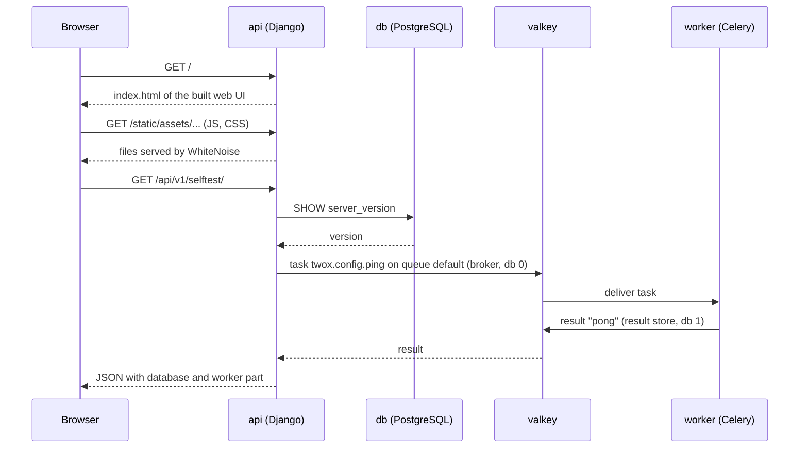

# Architecture

This document describes the scaffold as it exists after milestone M0: containers, repository layout, compose files, the path of a request through the layers, the task queues, the generated API client, the configuration and the quality tools.
Features that do not exist yet (importing documents, search, answers with sources, profiles, login and roles) are only mentioned where the scaffold already reserves a place for them; their order is in [ROADMAP.md](ROADMAP.md).
How to start and check everything is in the [README](../README.md).

Versions are not repeated here. They are pinned in `backend/uv.lock`, `web/package-lock.json`, `backend/Dockerfile`, `web/Dockerfile` and the compose files under `deploy/compose/`.
Decisions and their reasons (numbered E-01, E-02, ...) are recorded in [DECISIONS.md](DECISIONS.md), in German.

## Containers

```mermaid
flowchart LR
  browser["Browser on the host"]
  ollama["Ollama on the host (optional)"]
  subgraph default["network: default"]
    api["api<br/>Django + DRF, uvicorn<br/>serves the web UI"]
    worker["worker<br/>Celery"]
    db[("db<br/>PostgreSQL + pgvector")]
    valkey[("valkey<br/>broker + result store")]
    migrate["migrate<br/>runs once"]
  end
  subgraph internal["network: docling-internal (internal, no internet)"]
    docling["docling<br/>docling-serve, CPU"]
  end
  browser -- "127.0.0.1:8000" --> api
  api --> db
  api --> valkey
  worker --> valkey
  migrate --> db
  api -. "check_docling" .-> docling
  worker -.-> docling
  api -. "check_llm via host.docker.internal" .-> ollama
  worker -.-> ollama
```

| Service | Image | Task in M0 |
| --- | --- | --- |
| `api` | `backend/Dockerfile`, target `runtime` | Django with Django REST Framework under uvicorn (ASGI). Serves the API below `/api/v1/` and the built web UI at `/` and `/static/`. The only service with a host port: `127.0.0.1:${TWOX_API_PORT}` to container port 8000. |
| `worker` | same image as `api` | Celery worker that consumes the queues `ingest`, `embed` and `default`. Its health check pings exactly this worker through the broker. |
| `migrate` | same image as `api` | Applies the database migrations and exits. A separate service, so that several API instances never migrate at the same time; `api` and `worker` wait until it has completed successfully. |
| `db` | `pgvector/pgvector` | PostgreSQL with the pgvector extension available. Data in the volume `db-data`. In M0 it holds only Django's own tables and the user table. |
| `valkey` | `valkey/valkey` | Redis-compatible broker (database 0) and result store (database 1) for Celery. Data in the volume `valkey-data`. No host port. |
| `docling` | `docling-serve-cpu` from quay.io, pinned by tag and digest | Document conversion service, used from milestone M2 on. In M0 only `check_docling` talks to it. No host port, no volume: the models ship in the image. |

Ollama is not a container. It runs on the host, and `api` and `worker` reach it through `host.docker.internal` (`extra_hosts: host.docker.internal:host-gateway`).
Nothing in M0 calls a model; the command `check_llm` only asks for the model list.

`api`, `worker` and `migrate` run as the non-root user `twox` (UID 10001) of the backend image; `docling` runs as the non-root user its image defines.
`api`, `worker`, `db`, `valkey` and `docling` have health checks, so `docker compose up -d --wait` returns only when they are healthy.
`api` and `worker` do not depend on `docling`: they start while Docling is still starting or when it is missing.

### Networks

- `default`: all services except `docling`. It has a route to the outside, which `api` and `worker` need to reach Ollama on the host.
- `docling-internal`: marked `internal: true`, so it has no route to the internet. Only `docling`, `api` and `worker` are attached (decision E-32).
  Together with the telemetry switches in `deploy/compose/compose.yaml` this keeps docling-serve from downloading or sending anything.
  The development service `backend-dev` is deliberately not attached, so `check_docling` has to run in `api` or `worker`.

### Restrictions on Docling

- Only the OCR engine RapidOCR is allowed (decision E-31). The service rejects every other OCR preset with HTTP 422, including the default `auto`, so every conversion request from the backend will have to send `ocr_preset: "rapidocr"`.
- Because the warm-up at boot would use `auto`, models are not loaded at boot (`DOCLING_SERVE_LOAD_MODELS_AT_BOOT=false`). Healthy therefore means "server and queue run"; the models load with the first conversion.

## Images

`backend/Dockerfile` is built with the repository root as context. The root `.dockerignore` is a positive list that admits only `backend/` and `web/`.

| Stage | Purpose |
| --- | --- |
| `base`, `builder`, `runtime-deps` | Python base, uv, and the virtual environment in `/opt/venv` from `backend/uv.lock` (without development packages). |
| `dev` | Development and CI tooling (Ruff, mypy, pytest, pip-licenses). Runs as root so that writes into the bind-mounted source tree work. Used by `backend-dev`. No web UI. |
| `web-build` | Node stage: `npm ci`, `npm run build` of `web/`, then writes `THIRD-PARTY-NOTICES.txt` next to the build. Nothing of Node reaches the runtime image. |
| `static` | Runs `collectstatic` once at build time, without a database. |
| `runtime` | Application plus the collected static files, no development tools, no Node, user `twox`. Starts uvicorn. Used by `api`, `worker` and `migrate`. |

`web/Dockerfile` has a single stage `dev` (Node) for the web tooling; it is used only by `web-dev`.

## Repository layout

```
backend/                 Django project (Python), Dockerfile, uv project
  twox/config/           settings, URLs, ASGI, Celery app, self-test, health, web UI view
  twox/<app>/            the eight Django apps (see below)
  tests/                 pytest tests, one folder per app plus config
  scripts/               licence check of the Python packages
web/                     web UI (React, TypeScript, Vite, Tailwind CSS)
  src/                   application code and Vitest tests
  src/api/generated/     API client generated from the OpenAPI schema (checked in)
  openapi/               OpenAPI schema of the backend (checked in)
  e2e/                   Playwright test of the test page
  scripts/               licence check of the npm packages
deploy/compose/          compose files and the Dockerfile of the test factory tools
testfactory/             test factory: manifest, fetch script, layout, test questions
testdata/klein/          small, freely licensed documents for automatic tests
docs/                    roadmap, decisions, status, this file, work orders
.github/workflows/       CI (ci.yml) and secret scan (secrets.yml)
compose.yaml             entry point for docker compose (includes deploy/compose/)
```

Not present yet: `deploy/helm` (later), `testfactory/generated/` (configurations produced with vendor software, milestone T2).
`testfactory/extern/` exists only on a developer's machine after running `fetch.py`; Git ignores it.

### Django apps

All apps live below `backend/twox/` and are installed in `backend/twox/config/settings.py`. In M0 most of them are empty placeholders that fix the structure.

| App | Intended purpose | Content in M0 |
| --- | --- | --- |
| `config` | Project package (not an app): settings, URLs, ASGI, Celery application. | Settings, `urls.py`, `asgi.py`, `celery.py`, the task `ping` (`tasks.py`), the queue access (`taskqueue.py`), the views for health, self-test and the web UI. |
| `assets` | Structure of the company: site, area, plant, device. | empty |
| `files` | Documents and configuration files with versions and storage. | empty |
| `ingest` | Import jobs, the connection to Docling, text sections. | management command `check_docling` |
| `search` | Search interface and its PostgreSQL implementation (full text, trigrams, vectors). | empty |
| `answers` | Answers with sources, connection to the language model. | management command `check_llm` |
| `profiles` | Device profile with proposed and confirmed fields. | empty |
| `accounts` | Login, roles, audit log. | custom user model `accounts.User` (an unchanged subclass of Django's `AbstractUser`), set before the first migration because changing it later is costly; no login yet |
| `importers` | Plugin interface and the bundled importers for vendor formats. | empty |

## Compose files

```
compose.yaml                         include: deploy/compose/compose.yaml
                                              deploy/compose/compose.web.yaml
deploy/compose/compose.yaml          db, valkey, migrate, api, worker, docling;
                                     backend-dev (profile dev); networks and volumes
deploy/compose/compose.web.yaml      web-dev (profile dev), e2e (profile e2e);
                                     volume web_node_modules
deploy/compose/compose.tools.yaml    gitleaks-dir, gitleaks-git (used with -f)
deploy/compose/testfactory.yaml      fetch, check, check-offline (used with -f)
```

- The root `compose.yaml` only includes the two files, so that plain `docker compose ...` works from the repository root and all services share one project and one network (the browser test reaches `api` that way).
- Paths in the files under `deploy/compose/` are relative to that folder. Values come from the `.env` file in the repository root; the compose file stops with "Copy .env.example to .env first" if a required value is missing.
- **Profiles:** services in a profile start only when the profile is given or the service is named. `dev` holds the tooling containers `backend-dev` (the `dev` image with `backend/` bind-mounted, depends on `db` only) and `web-dev` (`web/` bind-mounted, `node_modules` in a named volume). `e2e` holds the Playwright container, which uses the packages that `web-dev` installed in the shared volume.
  Because of the profiles, a full clean-up needs `docker compose --profile dev --profile e2e down -v`.
- `compose.web.yaml` is also valid on its own; the CI job `web` runs it with `-f`.
- `compose.tools.yaml` and `testfactory.yaml` are not included. Their services run without network (`gitleaks-*`, `check-offline`) or only with what they need (`fetch` downloads vendor material).

## Path of a request: the test page

The test page proves that every layer works: browser, Django, database, broker, worker and back.



1. **Web UI.** `GET /` is answered by the view in `backend/twox/config/webui.py`, which returns the `index.html` of the built UI with `Cache-Control: no-cache`. The UI was built by Vite with the base path `/static/`; the image build copied it into Django's static files, and WhiteNoise serves them below `/static/`. There is no Node server at runtime. Only `/` maps to the UI; every other unknown path stays a 404.
2. **API call.** The page (`web/src/SelftestPage.tsx`) calls `GET /api/v1/selftest/` through the generated client (relative URL, same origin as the page). The wrapper `web/src/api/selftest.ts` turns network errors, a 15-second timeout, HTTP errors and malformed answers into distinct states the page can show.
3. **Database.** `backend/twox/config/selftest.py` reads `SHOW server_version` from PostgreSQL; no table is involved.
4. **Broker and worker.** The self-test calls `ping_worker()` in `backend/twox/config/taskqueue.py`, the one place where the API talks to the task queue. It sends the task `twox.config.ping` to the queue `default` with one connection attempt, bounded socket timeouts and an expiry, and waits at most 5 seconds for the result. For the result store it uses an own Celery app with the same settings plus short socket timeouts and no retries; the app of the worker keeps Celery's defaults. The API first checks the result store and subscribes to the result, then sends the task. The worker returns `pong`; the API reads the result from the result store and then deletes it.
5. **Answer.** The view always answers HTTP 200 with a `database` part (`ok`, `server_version`, `error`) and a `worker` part (`ok`, `result`, `duration_ms`, `error`). A failing part has `ok: false` and a short error text without addresses, credentials or tracebacks; details go to the server log only.

If the broker answers but the result store does not, the worker part reports `result store not reachable` after about 5 seconds. Known limit: if the result store stops answering in the middle of a call, deleting the result can add up to one more socket timeout (5 seconds).
`GET /api/v1/selftest/` is open to everyone in M0 on purpose; milestone M1 restricts it to signed-in users.

## Task queues

Celery is configured in `backend/twox/config/settings.py` (prefix `CELERY_`) and `backend/twox/config/celery.py`. Valkey is addressed through Celery's Redis transport, hence `redis://` URLs (decision E-29). Messages and results are JSON only; nothing is unpickled.

| Queue | Intended for | Used in M0 |
| --- | --- | --- |
| `ingest` | Importing files: conversion with Docling, reading configuration files (from M2). | no (round trip tested by `pytest -m worker`) |
| `embed` | Computing embeddings for text sections (from M2). | no (round trip tested by `pytest -m worker`) |
| `default` | Everything else. Default queue for tasks without a route. | the self-test task `ping` |

- Each queue has its own direct exchange and routing key of the same name, so a message for one queue never reaches another.
- `task_create_missing_queues` is off: a misspelled queue name is an error, not a new queue nobody consumes.
- One `worker` service consumes all three queues. Splitting it into one service per queue only needs a different `--queues` list in `deploy/compose/compose.yaml`.

## API and the generated client

- **API.** Django REST Framework, JSON only (no browsable API). The default permission is "authenticated" and no authentication method is configured until M1, so a view is open only if it says so itself. Open in M0: `GET /api/v1/health/` (process alive, used by the container health check) and `GET /api/v1/selftest/`. There is no schema endpoint.
- **Schema.** drf-spectacular generates the OpenAPI description from the views and serializers with `python manage.py spectacular`. It is checked in as `web/openapi/schema.yml`.
- **Client.** `@hey-api/openapi-ts` (configured in `web/openapi-ts.config.ts`, run with `npm run api:generate`) generates types, SDK functions and a fetch client into `web/src/api/generated/`. The generated code is checked in, never edited by hand, and has no runtime dependency: the fetch client is copied in as source.
- **Use.** The UI calls the API only through the generated client, wrapped by small hand-written modules such as `web/src/api/selftest.ts`.
- **Kept in sync by CI.** The job `backend` regenerates the schema and fails if `web/openapi/` changes; the job `web` regenerates the client from the checked-in schema and fails if `web/openapi/` or `web/src/api/` changes. Together this covers backend, schema and client. Step-by-step instructions: [web/openapi/README.md](../web/openapi/README.md).

## Configuration

Every deployment-specific value comes from an environment variable with the prefix `TWOX_` (the project name cannot start with a digit). Compose reads them from `.env` in the repository root, a copy of `.env.example`, and passes them to `migrate`, `api`, `worker` and `backend-dev`. `.env` is ignored by Git.

| Variable | Meaning | Value in `.env.example` | If unset or empty |
| --- | --- | --- | --- |
| `TWOX_SECRET_KEY` | Django secret key. | development-only value | required: compose stops |
| `TWOX_DEBUG` | Django debug mode (detailed error pages). Development only; leave empty or `false` everywhere else. | `true` | off |
| `TWOX_ALLOWED_HOSTS` | Comma-separated host names Django answers to. Must contain `localhost`, because the health check of `api` calls `http://localhost:8000/api/v1/health/`. | `localhost,127.0.0.1` | empty list: every request is rejected |
| `TWOX_API_PORT` | Host port of `api`, published on `127.0.0.1` only. | `8000` | `8000` |
| `TWOX_DB_HOST` | PostgreSQL host. | `db` | `db` |
| `TWOX_DB_PORT` | PostgreSQL port. | `5432` | `5432` |
| `TWOX_DB_NAME` | Database name; also creates the database in `db`. | `twox` | required: compose stops |
| `TWOX_DB_USER` | Database user; also creates the user in `db`. | `twox` | required: compose stops |
| `TWOX_DB_PASSWORD` | Database password; also set in `db`. | development-only value | required: compose stops |
| `TWOX_CELERY_BROKER_URL` | Celery broker (Valkey, database 0). | `redis://valkey:6379/0` | `redis://valkey:6379/0` |
| `TWOX_CELERY_RESULT_BACKEND` | Celery result store (Valkey, database 1). | `redis://valkey:6379/1` | `redis://valkey:6379/1` |
| `TWOX_LLM_BASE_URL` | OpenAI-compatible model server; read by `check_llm`, used by answers later. | `http://host.docker.internal:11434/v1` | same |
| `TWOX_DOCLING_URL` | docling-serve; read by `check_docling`, used by the import later. | `http://docling:5001` | same |

The image build and the browser test use two further variables internally (the path of the built web UI during `collectstatic` in `backend/Dockerfile`, and the address of `api` for Playwright in `deploy/compose/compose.web.yaml`). They have built-in defaults and are not part of `.env`.

## Quality tools

Everything runs in containers with the same commands locally and in CI. The exact commands are in the README and in `.github/workflows/ci.yml`.

| Area | Tool | Command (inside the container) |
| --- | --- | --- |
| Python lint and format | Ruff (settings in `backend/pyproject.toml`) | `ruff check .`, `ruff format --check .` |
| Python types | mypy in strict mode with the Django and DRF plugins | `mypy .` |
| Python tests | pytest with pytest-django, against the real PostgreSQL in `db` | `pytest` (skips the tests marked `worker`) |
| Worker round trip | pytest, marker `worker`; needs `valkey` and `worker` running | `pytest -m worker` |
| Migrations | Django | `python manage.py makemigrations --check --dry-run` |
| Python licences | `backend/scripts/check-licenses.sh` (pip-licenses plus rules in `backend/scripts/license-rules.txt`) | `sh scripts/check-licenses.sh` |
| OpenAPI schema | drf-spectacular | `python manage.py spectacular --file ...`, then `git diff --exit-code` |
| Web lint | ESLint (typescript-eslint, React hooks rules) | `npm run lint` |
| Web types | TypeScript | `npm run typecheck` |
| Web tests | Vitest with Testing Library and jsdom | `npm run test` |
| Web build | Vite | `npm run build` |
| npm licences | `web/scripts/check-licenses.sh` (license-checker-rseidelsohn plus rules) | `npm run licenses` |
| API client | @hey-api/openapi-ts | `npm run api:generate`, then `git diff --exit-code` |
| Browser test | Playwright with Chromium, service `e2e` | `npm run e2e` (the container's default command) |
| Test factory | Ruff, mypy, unittest, manifest checks (`testfactory/README.md`) | see `deploy/compose/testfactory.yaml` |
| Secrets | gitleaks, rules in `.gitleaks.toml` | services `gitleaks-dir` (working directory) and `gitleaks-git` (history) |

### What CI runs

`.github/workflows/ci.yml` runs on every push and pull request, with four jobs:

- `backend`: builds the images, starts `db`, `valkey`, `worker` and `api`, then Ruff, mypy, `pytest`, `pytest -m worker`, the migration check, the Python licence check and the schema check.
- `web`: `npm ci`, lint, type check, Vitest, build, npm licence check and the client check.
- `testfactory`: Ruff, mypy, unit tests without network, and the checks of both manifest files. It never runs `fetch.py` and verifies at the end that no vendor material was downloaded.
- `e2e`: builds and starts the same services as `backend` and runs the Playwright test against the test page.

`.github/workflows/secrets.yml` runs `gitleaks-git` over the full history on every push and pull request.

### What CI does not run

- **Docling:** the `docling` service is never started in CI (image too large for the hosted runners and not needed yet); `check_docling` runs only locally.
- **Ollama:** there is no model server in CI; `check_llm` runs only locally.
- **Test questions:** `testfactory/questions.yaml` holds the test questions with their expected answers and sources. CI checks only their format (unit tests); running them against the application needs the answer feature (milestone M3) and is planned for later milestones.
- **Fetching vendor material:** `testfactory/fetch.py` is never run in CI.
