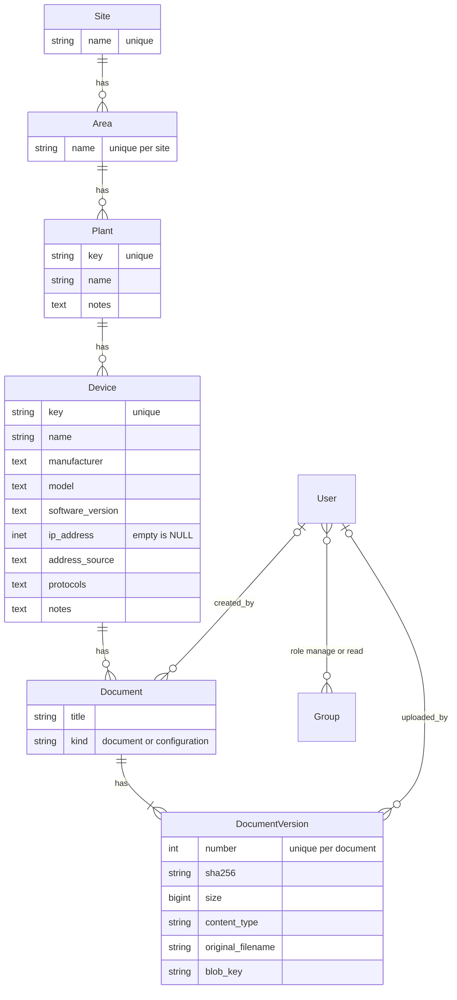
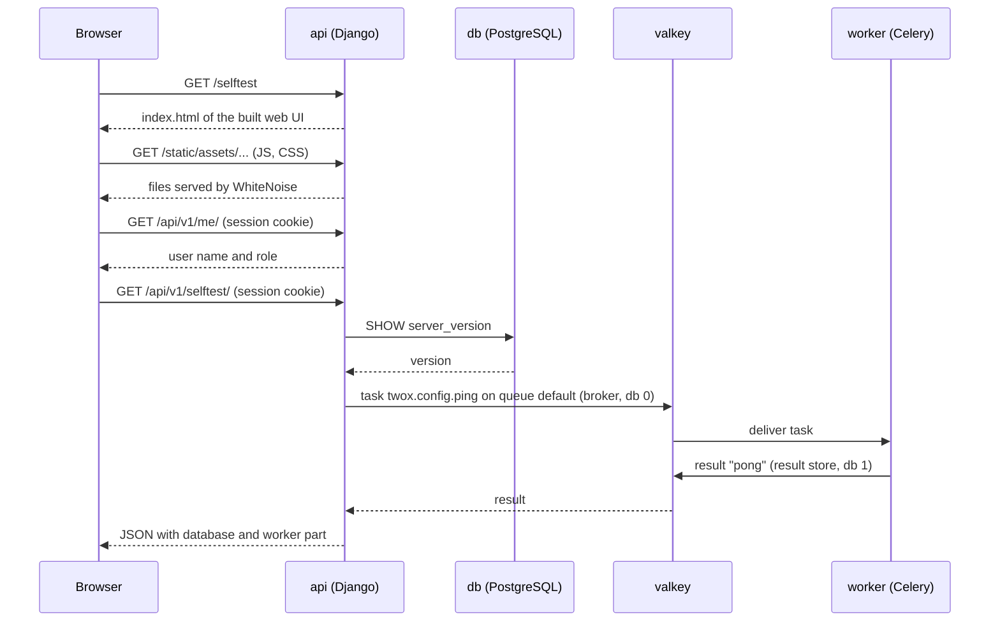

# Architecture

This document describes 2x as it exists on `main` after milestone M1 (devices and files): containers, repository layout, the Django apps and their data model, the file storage, sign-in and roles, the change log, the API, how the web UI is served and translated, the configuration and the quality tools.
Features that do not exist yet (reading documents, search, answers with sources, profiles, configuration files) are only mentioned where the code already reserves a place for them; their order is in [ROADMAP.md](ROADMAP.md) (in German). The interactive map of milestone M1b (work order 039) is in progress and not described here.
How to start and use 2x is in the [README](../README.md). Known limits are collected at the end, under [Limits and known gaps](#limits-and-known-gaps).

Versions are not repeated here. They are pinned in `backend/uv.lock`, `web/package-lock.json`, `backend/Dockerfile`, `web/Dockerfile` and the compose files under `deploy/compose/`.
Decisions and their reasons (numbered E-01, E-02, ...) are recorded in [DECISIONS.md](DECISIONS.md), in German.

## Containers

```mermaid
flowchart LR
  browser["Browser on the host"]
  ollama["Ollama on the host (optional)"]
  subgraph default["network: default"]
    api["api<br/>Django + DRF, uvicorn<br/>serves the web UI and the admin"]
    worker["worker<br/>Celery"]
    db[("db<br/>PostgreSQL + pgvector")]
    valkey[("valkey<br/>broker, result store, cache")]
    migrate["migrate<br/>runs once"]
    media[("volume media-data<br/>uploaded files")]
  end
  subgraph internal["network: docling-internal (internal, no internet)"]
    docling["docling<br/>docling-serve, CPU"]
  end
  browser -- "127.0.0.1:8000" --> api
  api --> db
  api --> valkey
  api --> media
  worker --> valkey
  worker --> media
  migrate --> db
  api -. "check_docling" .-> docling
  worker -.-> docling
  api -. "check_llm via host.docker.internal" .-> ollama
  worker -.-> ollama
```

| Service | Image | Task in M1 |
| --- | --- | --- |
| `api` | `backend/Dockerfile`, target `runtime` | Django with Django REST Framework under uvicorn (ASGI). Serves the API below `/api/v1/`, the sign-in API of django-allauth below `/_allauth/`, the Django admin below `/admin/`, the built web UI for every other page path and its files below `/static/`. Mounts the volume `media-data` at `/data/media`. The only service with a host port: `127.0.0.1:${TWOX_API_PORT}` to container port 8000. |
| `worker` | same image as `api` | Celery worker that consumes the queues `ingest`, `embed` and `default`. Mounts `media-data` as well, for the import of later milestones. Its health check pings exactly this worker through the broker. |
| `migrate` | same image as `api` | Applies the database migrations and exits. A separate service, so that several API instances never migrate at the same time; `api` and `worker` wait until it has completed successfully. |
| `db` | `pgvector/pgvector` | PostgreSQL with the pgvector extension available. Data in the volume `db-data`: accounts and sessions, the structure, files and versions (metadata only), the change log. |
| `valkey` | `valkey/valkey` | Redis-compatible store: Celery broker (database 0), Celery result store (database 1) and Django cache (database 2), which holds the counters of the sign-in rate limit. Data in the volume `valkey-data`. No host port. |
| `docling` | `docling-serve-cpu` from quay.io, pinned by tag and digest | Document conversion service, used from milestone M2 on. In M1 only `check_docling` talks to it. No host port, no volume: the models ship in the image. |

Ollama is not a container. It runs on the host, and `api` and `worker` reach it through `host.docker.internal` (`extra_hosts: host.docker.internal:host-gateway`).
Nothing in M1 calls a model; the command `check_llm` only asks for the model list.

`api`, `worker` and `migrate` run as the non-root user `twox` (UID 10001) of the backend image; `docling` runs as the non-root user its image defines.
`/app` in the runtime image belongs to root and is read-only for `twox`; the only place `twox` writes to is `/data/media`.
`api`, `worker`, `db`, `valkey` and `docling` have health checks, so `docker compose up -d --wait` returns only when they are healthy.
`api` and `worker` do not depend on `docling`: they start while Docling is still starting or when it is missing.

### Networks

- `default`: all services except `docling`. It has a route to the outside, which `api` and `worker` need to reach Ollama on the host.
- `docling-internal`: marked `internal: true`, so it has no route to the internet. Only `docling`, `api` and `worker` are attached (decision E-32).
  Together with the telemetry switches in `deploy/compose/compose.yaml` this keeps docling-serve from downloading or sending anything.
  The development service `backend-dev` is deliberately not attached, so `check_docling` has to run in `api` or `worker`.

### Restrictions on Docling

- Only the OCR engine RapidOCR is allowed (decision E-31). The service rejects every other OCR preset with HTTP 422, including the default `auto`, so every conversion request from the backend will have to send `ocr_preset: "rapidocr"`.
- Because the warm-up at boot would use `auto`, models are not loaded at boot (`DOCLING_SERVE_LOAD_MODELS_AT_BOOT=false`). Healthy therefore means "server and queue run"; the models load with the first conversion.

## Images

`backend/Dockerfile` is built with the repository root as context. The root `.dockerignore` is a positive list that admits only `backend/` and `web/` (and keeps compiled `.mo` files out).

| Stage | Purpose |
| --- | --- |
| `base`, `builder`, `runtime-deps` | Python base, uv, and the virtual environment in `/opt/venv` from `backend/uv.lock` (without development packages). |
| `dev` | Development and CI tooling (Ruff, mypy, pytest, pip-licenses) plus GNU gettext for `makemessages` and the tests. Runs as root so that writes into the bind-mounted source tree work. Used by `backend-dev`. No web UI. |
| `web-build` | Node stage: `npm ci`, `npm run build` of `web/`, then writes `THIRD-PARTY-NOTICES.txt` next to the build. The build fails if the list of runtime packages changes without the notice list. Nothing of Node reaches the runtime image. |
| `static` | Runs `collectstatic` once at build time, without a database: the web UI build and the files of the Django admin. |
| `locale-build` | Installs GNU gettext and compiles the translation catalogues (`compilemessages`); only the `.mo` files leave this stage. |
| `runtime` | Application, the collected static files and the compiled catalogues; no development tools, no Node, no gettext; user `twox`; the empty directory `/data/media` owned by `twox`. Starts uvicorn. Used by `api`, `worker` and `migrate`. |

`web/Dockerfile` has a single stage `dev` (Node) for the web tooling; it is used only by `web-dev`.

## Repository layout

```
backend/                 Django project (Python), Dockerfile, uv project
  twox/config/           settings, URLs, ASGI, Celery app, self-test, health, admin site, web UI view
  twox/<app>/            the eight Django apps (see below)
  locale/                German translation catalogue (django.po; .mo files are never committed)
  tests/                 pytest tests, one folder per app plus config
  scripts/               licence check of the Python packages
web/                     web UI (React, TypeScript, Vite, Tailwind CSS)
  src/                   application code and Vitest tests
  src/pages/             one file per page (README.md there explains routes and data fetching)
  src/components/        frame, navigation guards, shared components, files and change log
  src/locales/           translation catalogues de/en (README.md there)
  src/api/generated/     API client generated from the OpenAPI schema (checked in)
  openapi/               OpenAPI schema of the backend (checked in)
  e2e/                   Playwright tests (sign-in, structure, import, files, change log, languages, self-test)
  scripts/               licence check of the npm packages
deploy/compose/          compose files and the Dockerfile of the test factory tools
testfactory/             test factory: manifest, fetch script, layout (devices.csv), test questions
testdata/klein/          small, freely licensed documents for automatic tests
docs/                    roadmap, decisions, status, this file, work orders
.github/workflows/       CI (ci.yml) and secret scan (secrets.yml)
compose.yaml             entry point for docker compose (includes deploy/compose/)
```

Not present yet: `deploy/helm` (later), `testfactory/generated/` (configurations produced with vendor software, milestone T2).
`testfactory/extern/` exists only on a developer's machine after running `fetch.py`; Git ignores it.

### Django apps

All apps live below `backend/twox/` and are installed in `backend/twox/config/settings.py`. Four of them are still empty placeholders that fix the structure for later milestones.

| App | Intended purpose | Content in M1 |
| --- | --- | --- |
| `config` | Project package (not an app): settings, URLs, ASGI, Celery application. | Settings, `urls.py`, `asgi.py` (with the upload limit), `celery.py`, the task `ping` (`tasks.py`), the queue access (`taskqueue.py`), the views for health, self-test and the web UI, the admin site for superusers (`admin_site.py`). |
| `assets` | Structure of the company: site, area, plant, device. | Models `Site`, `Area`, `Plant`, `Device`; API (`/api/v1/sites/`, `areas/`, `plants/`, `devices/`); admin; CSV import of the device list (`csv_import.py`, endpoint `/api/v1/imports/devices/`, command `import_devices`). |
| `files` | Documents and configuration files with versions and storage. | Models `Document`, `DocumentVersion`; the blob storage interface (`storage.py`); upload services with checksum, duplicates and version numbers (`services.py`); upload limit (`uploads.py`); safe downloads (`downloads.py`); API; read-only admin; command `remove_stale_uploads`. |
| `accounts` | Sign-in, roles, change log. | Custom user model `accounts.User` (an unchanged subclass of Django's `AbstractUser`); the roles and their DRF permission classes (`roles.py`, `permissions.py`); the allauth adapter (`adapter.py`); `/api/v1/me/`; the change log (`audit.py`, `/api/v1/audit-log/`, read-only admin); command `create_account`. |
| `ingest` | Import jobs, the connection to Docling, text sections. | management command `check_docling` |
| `answers` | Answers with sources, connection to the language model. | management command `check_llm` |
| `search` | Search interface and its PostgreSQL implementation (full text, trigrams, vectors). | empty |
| `profiles` | Device profile with proposed and confirmed fields. | empty |
| `importers` | Plugin interface and the bundled importers for vendor formats (milestone M2 on). | empty; the CSV import of the device list lives in `assets`, because it reads no vendor format |

## Data model



- **Structure** (decision E-41, `twox/assets/models.py`): `Site` and `Area` have a name, `Plant` and `Device` a key and a name. A key consists of lower-case letters, digits and `-` (at most 64 characters, checked by `full_clean()`), and is unique among all plants or among all devices. The device fields are the columns of `testfactory/layout/devices.csv` one to one as free text; only `ip_address` is checked (IPv4 or IPv6, empty is `NULL`). All four have `created_at` and `updated_at`.
- **Files** (decision E-42, `twox/files/models.py`): a `Document` belongs to a device and has a title, a kind (`document` or `configuration`, checked by a database constraint), `created_at` and `created_by`. Each upload of it is a `DocumentVersion` with a number counted from 1, the SHA-256 checksum, size, content type, the cleaned original file name, `uploaded_by`, `created_at` and the key of its content in the blob storage. The content itself is not in the database.
  A version is immutable: `save()` on an existing version raises `VersionImmutableError`.
- **Accounts:** `accounts.User` is Django's user; a role is membership in one of the two groups `manage` or `read`, created by a data migration (decision E-40).
- **Deleting:** every foreign key uses `PROTECT`. An entry that still has children (an area with plants, a device with documents, a user with uploads) cannot be deleted. In M1 only a superuser deletes, and only structure entries in the admin.
- **Change log:** the table `auditlog_logentry` of django-auditlog (see [Change log](#change-log)).
- **Sessions** are stored in the database (`django_session`); allauth adds its tables for email addresses, which stay unused.

## File storage

All file content goes through the interface in `twox/files/storage.py` (decision E-42); no other code touches the files.

- `BlobStorage` is a protocol with three operations: `store_blob(stream) -> StoredBlob` (key, SHA-256, size), `open_blob(key)` and `blob_exists(key)`. There is no delete and no URL. `get_blob_storage()` returns the configured implementation.
- **Content-addressed:** the key is derived from the SHA-256 of the bytes, `sha256/ab/cd/<sha256>`. The same content is stored once, however often it is uploaded; a stored name never depends on device or file names. Keys are checked strictly before any file system access.
- **Atomic:** `FileSystemBlobStorage` writes to a temporary file `upload-*.part` below `<TWOX_MEDIA_ROOT>/tmp/` in blocks of 1 MiB, computes checksum and size on the way, calls `fsync`, makes the file read-only (`0440`) and only then links it under its key with `os.link`, which never replaces an existing file. Of two writers of the same content exactly one creates the entry. A failed or aborted write removes the temporary file.
- **Where:** the volume `media-data`, mounted at `/data/media` in `api` and `worker` (`TWOX_MEDIA_ROOT`). An implementation for S3-compatible storage can be added later behind the same interface without changes elsewhere.
- **Services** (`twox/files/services.py`): `create_document` and `add_version` check kind and size, store the content, lock the document, count the version number and save the rows in one transaction. Content equal to the newest version of the same file is refused (HTTP 409 in the API); equal content elsewhere is accepted and reported as a duplicate with device, file and version. File names lose path parts and control characters; a content type that is missing or invalid becomes `application/octet-stream`.
- **Upload limit** (`twox/files/uploads.py`, `TWOX_UPLOAD_MAX_BYTES`): Django's ASGI handler reads a whole request body into a temporary file before any view runs. A wrapper around the ASGI application (`twox/config/asgi.py`) therefore refuses a body above the limit plus 64 KiB for the form fields with HTTP 413 before Django reads it, also when the body comes without a length. The upload views check `Content-Length` again, count the file bytes while Django parses them, and the services check the size once more.
- **Downloads** (`twox/files/downloads.py`) are always attachments, streamed in blocks of 64 KiB, with `X-Content-Type-Options: nosniff`, `Content-Security-Policy: sandbox` and a content type from an allow-list (PDF, Office, OpenDocument, Markdown, plain text, raster images without SVG); anything else is sent as `application/octet-stream`.
- **Configurations:** the kind `configuration` exists in the model, but the services refuse it until redaction of credentials arrives in milestone M5 (guideline 5, decision E-42).

## Sign-in and sessions

- **django-allauth, headless** (decision E-38): allauth renders no pages. The web UI has its own sign-in page `/login` and talks to allauth's browser API at the same origin: `POST /_allauth/browser/v1/auth/login` (user name and password), `GET` and `DELETE /_allauth/browser/v1/auth/session`, `GET /_allauth/browser/v1/config`. Only the client `browser` is enabled. These endpoints are not part of the OpenAPI schema; the UI calls them through `web/src/api/auth.ts`.
- **Session and CSRF:** after sign-in the browser holds Django's session cookie (`HttpOnly`, `SameSite=Lax`, 8 hours); the session is stored in the database. Every page of the UI sets the cookie `csrftoken`, and every writing request sends its value in the header `X-CSRFToken`. DRF uses `SessionAuthentication` only; there is no token and no HTTP basic authentication.
- **Closed endpoints:** M1 offers no self-registration (`AccountAdapter.is_open_for_signup` is false), sends no email and has no self-service for passwords or email addresses. The allauth endpoints for changing or resetting a password and for email addresses answer 404 (`CLOSED_ALLAUTH_PATH` in `twox/config/urls.py`). `/accounts/` is included for the callback URLs of OpenID Connect later and registers no path today.
- **Passwords:** at least 12 characters and Django's three other standard validators.
- **Rate limit:** `ACCOUNT_RATE_LIMITS` in the settings: failed sign-ins 10 per minute per IP address and 5 per 5 minutes per account, sign-in attempts 30 per minute per IP address. allauth counts in Django's cache, which is `RedisCache` on Valkey database 2 (`TWOX_CACHE_URL`), so all API processes share the counters and a restart does not reset them. A locked account gets HTTP 400 with `too_many_login_attempts`, the per-IP limit HTTP 429. The adapter logs failed and blocked sign-ins with the user name only.
- **Admin:** `twox/config/admin_site.py` lets only active superusers in and replaces the admin's sign-in form: `/admin/login/` redirects anonymous visitors to `/login?next=/admin/...` (only paths below `/admin/` are accepted as `next`) and never signs anyone in. A signed-in account without access gets 403.
- **Accounts on the command line:** `create_account <name> --role manage|read [--update]` reads the password from `TWOX_ACCOUNT_PASSWORD` or asks twice in a terminal; it never sets `is_staff` or `is_superuser`. Superusers come from Django's `createsuperuser`.

## Roles and API permissions

- Two roles (decision E-40): `read` and `manage`, as Django groups. `user_role()` in `twox/accounts/roles.py` gives `None` for anonymous, inactive and role-less users, `manage` for superusers and for members of both groups.
- Three DRF permission classes in `twox/accounts/permissions.py`: `CanRead` (any method, any role), `CanManageOrReadOnly` (reading for both roles, writing for `manage`), `CanManage` (only `manage`). All three answer 403 to anonymous and role-less requests.
- **Closed by default:** `DEFAULT_PERMISSION_CLASSES` is `CanRead`, so a view without its own class needs a role. The test `backend/tests/config/test_api.py` walks through every URL below `/api/v1/`, calls it with every method as anonymous and as a role-less user and fails if anything other than the listed exceptions answers with something other than 403. Exceptions: `OPEN_PATHS` = `/api/v1/health/` (anonymous, for the container health check) and `ROLELESS_PATHS` = `/api/v1/me/` (any signed-in user); another test checks that each exception is still needed.

| Endpoint | Methods | Permission |
| --- | --- | --- |
| `/api/v1/health/` | GET | open |
| `/api/v1/me/` | GET: user name, role, superuser flag | signed in |
| `/api/v1/selftest/` | GET | `CanRead` |
| `/api/v1/sites/`, `areas/`, `plants/`, `devices/` and `{id}/` | GET list and detail; POST, PUT, PATCH; no DELETE (405) | `CanManageOrReadOnly` |
| `/api/v1/imports/devices/` | POST `multipart/form-data` with `file` and `dry_run` (default true); always 200 with a report, 400 only for an invalid form, 413 above the upload limit | `CanManage` |
| `/api/v1/devices/{device_id}/documents/` | GET the files of a device; POST a new file (`file`, `title`, `kind`) | `CanManageOrReadOnly` |
| `/api/v1/documents/{document_id}/` | GET a file with all versions | `CanRead` |
| `/api/v1/documents/{document_id}/versions/` | POST a new version; 409 for content equal to the newest version | `CanManageOrReadOnly` |
| `/api/v1/document-versions/{version_id}/download/` | GET the content as attachment | `CanRead` |
| `/api/v1/document-versions/{version_id}/ingest/` | POST: start ingesting the version again; 202 with the new job, 409 while a job is queued or running, 400 for a configuration | `CanManage` |
| `/api/v1/ingest-jobs/` | GET, 50 jobs per page, newest first, with document, version and device; filters `status` (repeatable), `device`, `document`, `version`; `requested_by` only for `manage`, `null` for `read` | `CanRead` |
| `/api/v1/audit-log/` | GET, 50 entries per page, newest first; filters `object_type`, `object_id`, `actor` | `CanManage` |

Every version in the files endpoints carries `ingest`: its newest ingest job (status, step, error code, cleaned error detail, counts, times) or `null`, loaded with one extra query for the whole answer. Error code and error detail are shown to both roles (E-57).

The lists of areas, plants and devices filter by their parents (`areas?site=`, `plants?area=`, `devices?plant=`, `devices?site=`). Two requests that create the same key at the same moment end with one success and one HTTP 400 at the field: the views turn the violated unique constraint into a field error.

## Change log

- **django-auditlog** (decision E-43), registered in `twox/accounts/audit.py`: `Site`, `Area`, `Plant`, `Device`, `Document`, `DocumentVersion` with all their own columns, and `User` without `password` and `last_login`, with its groups (role changes). Creating, changing and deleting each write one entry with time, action, object, actor and the changed fields as `[old, new]` JSON values (`AUDITLOG_STORE_JSON_CHANGES`). A role change writes two entries (old group removed, new group added).
- **Actor:** during a request `AuditMiddleware` names the signed-in user. It is auditlog's middleware without any value from the request: no IP address (`AUDITLOG_DISABLE_REMOTE_ADDR`), no port from `X-Forwarded-Port`, no correlation id (`AUDITLOG_CID_HEADER = None`). Such client values could otherwise make writing the entry fail after the change was saved. Outside a request (the import command) the code wraps its work in `acting_as(user)`.
- **Reading:** `/api/v1/audit-log/` for `manage`; the page `/audit` and, on the file page, the entries of that file (component `AuditTrail`). In the admin the entries are read-only for superusers (no add, change or delete).
- **Writing:** only through `save()` and `delete()` of the registered models; there is no API to write or delete entries. The limits are listed under [Limits and known gaps](#limits-and-known-gaps).

## Serving the web UI

- Django serves the web UI itself; there is no Node server at runtime. Vite builds it with the base path `/static/`, the image build copies it into Django's static files, and WhiteNoise serves them below `/static/` (files below `/static/assets/` carry a content hash and are cached as immutable).
- **Every page path is the UI** (decision E-39): `/` and every path whose first segment is not `api`, `static`, `admin`, `_allauth` or `accounts` get the same `index.html` (`web_index` in `backend/twox/config/webui.py`, pattern `WEB_UI_PATH` in `urls.py`), with `Cache-Control: no-cache` and the CSRF cookie. So `/devices/7` can be opened directly or reloaded. Only GET and HEAD are allowed there. An unknown path below one of the five reserved segments stays a 404 from Django; an unknown page path is answered by the UI with its "not found" page.
- **Routes** (`web/src/routes.tsx`, react-router in data mode): `/` structure, `/devices/:deviceId`, `/documents/:documentId`, `/import`, `/audit`, `/login`, `/selftest`. Every page except `/login` requires a session (otherwise the UI goes to `/login?next=...` and back after signing in; `next` accepts only paths of this application) and a role (`web/src/navigation.ts`: `/import` and `/audit` need `manage`, the others `read`). A missing role shows "no permission" without a redirect. Details: [web/src/pages/README.md](../web/src/pages/README.md).
- **Data:** pages read and write through TanStack Query with the query and mutation options of the generated client. The sign-in state is one query on `/api/v1/me/`; a 403 from any other call makes the UI ask `me` again to tell an expired session from a missing permission.

## Translation

- **Web UI:** i18next with react-i18next. One JSON catalogue per language and namespace in `web/src/locales/<de|en>/`, bundled with the build (nothing is loaded over the network); TypeScript checks the keys against the English files. The first language comes from the stored choice or the browser, the switch in the header changes it. Details: [web/src/locales/README.md](../web/src/locales/README.md).
- **API:** Django's gettext. `LocaleMiddleware` picks German or English per request from `Accept-Language` (the UI sends the language it shows); without a match it answers in English. The German catalogue is `backend/locale/de/LC_MESSAGES/django.po`, regenerated with `makemessages -l de --add-location=file`; CI fails if it is out of date, and `pytest` fails while an entry is untranslated or fuzzy. The 413 answer of the ASGI wrapper is translated as well, although it is sent before Django runs.
- **Compiled catalogues** (`.mo`) are never committed (decision E-46). They exist only in the runtime image (built in the stage `locale-build`) and in the tests, which compile them into a temporary directory outside `/app`. GNU gettext (GPL) is a tool of the `dev` image and of `locale-build` only.

## Compose files

```
compose.yaml                         include: deploy/compose/compose.yaml
                                              deploy/compose/compose.web.yaml
deploy/compose/compose.yaml          db, valkey, migrate, api, worker, docling;
                                     backend-dev (profile dev); networks and volumes
deploy/compose/compose.web.yaml      web-dev (profile dev), e2e (profile e2e);
                                     volume web_node_modules
deploy/compose/compose.tools.yaml    gitleaks-dir, gitleaks-git (used with -f)
deploy/compose/testfactory.yaml      fetch, check, check-offline (used with -f)
```

- The root `compose.yaml` only includes the two files, so that plain `docker compose ...` works from the repository root and all services share one project and one network (the browser test reaches `api` that way).
- Paths in the files under `deploy/compose/` are relative to that folder. Values come from the `.env` file in the repository root; the compose file stops with "Copy .env.example to .env first" if a required value is missing.
- **Volumes:** `db-data`, `valkey-data`, `media-data` (uploaded files, `api` and `worker`) and `web_node_modules`.
- **Profiles:** services in a profile start only when the profile is given or the service is named. `dev` holds the tooling containers `backend-dev` (the `dev` image with `backend/` bind-mounted and `testfactory/layout/` mounted read-only at `/testfactory/layout`, depends on `db` only) and `web-dev` (`web/` bind-mounted, `node_modules` in a named volume). `e2e` holds the Playwright container, which uses the packages that `web-dev` installed in the shared volume and gets the test account from `TWOX_E2E_USERNAME` and `TWOX_E2E_PASSWORD`.
  Because of the profiles, a full clean-up needs `docker compose --profile dev --profile e2e down -v`.
- `compose.web.yaml` is also valid on its own; the CI job `web` runs it with `-f`.
- `compose.tools.yaml` and `testfactory.yaml` are not included. Their services run without network (`gitleaks-*`, `check-offline`) or only with what they need (`fetch` downloads vendor material).

## Path of a request: the self-test page

The self-test page proves that every layer works: browser, Django, database, broker, worker and back.



1. **Web UI.** `GET /selftest` is answered by the view in `backend/twox/config/webui.py` with the `index.html` of the built UI (see [Serving the web UI](#serving-the-web-ui)). Without a session the UI goes to the sign-in page first.
2. **API call.** The page (`web/src/pages/SelftestPage.tsx`) calls `GET /api/v1/selftest/` through the generated client (relative URL, same origin as the page, with the session cookie). The wrapper `web/src/api/selftest.ts` turns network errors, a 15-second timeout, HTTP errors and malformed answers into distinct states the page can show. The endpoint needs a signed-in user with a role (`CanRead`); otherwise it answers 403 and sends no task.
3. **Database.** `backend/twox/config/selftest.py` reads `SHOW server_version` from PostgreSQL; no table is involved.
4. **Broker and worker.** The self-test calls `ping_worker()` in `backend/twox/config/taskqueue.py`, the one place where the API talks to the task queue. It sends the task `twox.config.ping` to the queue `default` with one connection attempt, bounded socket timeouts and an expiry, and waits at most 5 seconds for the result. For the result store it uses an own Celery app with the same settings plus short socket timeouts and no retries; the app of the worker keeps Celery's defaults. The API first checks the result store and subscribes to the result, then sends the task. The worker returns `pong`; the API reads the result from the result store and then deletes it.
5. **Answer.** The view always answers HTTP 200 with a `database` part (`ok`, `server_version`, `error`) and a `worker` part (`ok`, `result`, `duration_ms`, `error`). A failing part has `ok: false` and a short error text without addresses, credentials or tracebacks; details go to the server log only.

If the broker answers but the result store does not, the worker part reports `result store not reachable` after about 5 seconds.

## Task queues

Celery is configured in `backend/twox/config/settings.py` (prefix `CELERY_`) and `backend/twox/config/celery.py`. Valkey is addressed through Celery's Redis transport, hence `redis://` URLs (decision E-29). Messages and results are JSON only; nothing is unpickled.

| Queue | Intended for | Used in M1 |
| --- | --- | --- |
| `ingest` | Importing files: conversion with Docling, reading configuration files (from M2). | no (round trip tested by `pytest -m worker`) |
| `embed` | Computing embeddings for text sections (from M2). | no (round trip tested by `pytest -m worker`) |
| `default` | Everything else. Default queue for tasks without a route. | the self-test task `ping` |

- Each queue has its own direct exchange and routing key of the same name, so a message for one queue never reaches another.
- `task_create_missing_queues` is off: a misspelled queue name is an error, not a new queue nobody consumes.
- One `worker` service consumes all three queues. Splitting it into one service per queue only needs a different `--queues` list in `deploy/compose/compose.yaml`.
- The CSV import runs synchronously in the request, not in the worker.

## API and the generated client

- **API.** Django REST Framework, JSON only (no browsable API); uploads use `multipart/form-data` in the views that take files. Permissions and endpoints: see [Roles and API permissions](#roles-and-api-permissions). There is no schema endpoint.
- **Schema.** drf-spectacular generates the OpenAPI description from the views and serializers with `python manage.py spectacular`. It is checked in as `web/openapi/schema.yml`. The allauth endpoints are not part of it.
- **Client.** `@hey-api/openapi-ts` (configured in `web/openapi-ts.config.ts`, run with `npm run api:generate`) generates types, SDK functions, a fetch client and, with its plugin `@tanstack/react-query`, query and mutation options per endpoint into `web/src/api/generated/`. The generated code is checked in and never edited by hand. The fetch client is copied in as source; the query options import the runtime package `@tanstack/react-query`.
- **Use.** The UI calls the API only through the generated client. `web/src/api/client.ts` adds `X-CSRFToken` to writing requests and `Accept-Language` to every request; `web/src/api/errors.ts` turns failures into an `ApiError`.
- **Kept in sync by CI.** The job `backend` regenerates the schema and fails if `web/openapi/` changes; the job `web` regenerates the client from the checked-in schema and fails if `web/openapi/` or `web/src/api/` changes. Together this covers backend, schema and client. Step-by-step instructions: [web/openapi/README.md](../web/openapi/README.md).

## Configuration

Every deployment-specific value comes from an environment variable with the prefix `TWOX_` (the project name cannot start with a digit). Compose reads them from `.env` in the repository root, a copy of `.env.example`, and passes them to `migrate`, `api`, `worker` and `backend-dev`. `.env` is ignored by Git.

| Variable | Meaning | Value in `.env.example` | If unset or empty |
| --- | --- | --- | --- |
| `TWOX_SECRET_KEY` | Django secret key. | development-only value | required: compose stops |
| `TWOX_DEBUG` | Django debug mode (detailed error pages). Development only; leave empty or `false` everywhere else. | `true` | off |
| `TWOX_ALLOWED_HOSTS` | Comma-separated host names Django answers to. Must contain `localhost`, because the health check of `api` calls `http://localhost:8000/api/v1/health/`. | `localhost,127.0.0.1` | empty list: every request is rejected |
| `TWOX_API_PORT` | Host port of `api`, published on `127.0.0.1` only. | `8000` | `8000` |
| `TWOX_DB_HOST` | PostgreSQL host. | `db` | `db` |
| `TWOX_DB_PORT` | PostgreSQL port. | `5432` | `5432` |
| `TWOX_DB_NAME` | Database name; also creates the database in `db`. | `twox` | required: compose stops |
| `TWOX_DB_USER` | Database user; also creates the user in `db`. | `twox` | required: compose stops |
| `TWOX_DB_PASSWORD` | Database password; also set in `db`. | development-only value | required: compose stops |
| `TWOX_CELERY_BROKER_URL` | Celery broker (Valkey, database 0). | `redis://valkey:6379/0` | `redis://valkey:6379/0` |
| `TWOX_CELERY_RESULT_BACKEND` | Celery result store (Valkey, database 1). | `redis://valkey:6379/1` | `redis://valkey:6379/1` |
| `TWOX_CACHE_URL` | Django cache (Valkey, database 2), shared by all API processes; holds the counters of the sign-in rate limit. | `redis://valkey:6379/2` | `redis://valkey:6379/2` |
| `TWOX_MEDIA_ROOT` | Directory of the uploaded files inside `api` and `worker`; must be an absolute path. Compose mounts the volume `media-data` at `/data/media`, so the two have to match. | `/data/media` | `/data/media` |
| `TWOX_UPLOAD_MAX_BYTES` | Largest accepted upload in bytes (a whole number greater than 0). | `200000000` (200 MB, decimal) | `200000000` |
| `TWOX_LLM_BASE_URL` | OpenAI-compatible model server; read by `check_llm`, used by answers later. | `http://host.docker.internal:11434/v1` | same |
| `TWOX_DOCLING_URL` | docling-serve; read by `check_docling`, used by the import later. | `http://docling:5001` | same |
| `TWOX_E2E_USERNAME`, `TWOX_E2E_PASSWORD` | Test account of the browser test. Passed only to the `e2e` container and used by the step "Create test account"; never use the values for a real account. | `e2e-manager`, a development-only password | the browser test cannot sign in |

`create_account` reads the password from `TWOX_ACCOUNT_PASSWORD` if it is set; it is not part of `.env` and is passed to the container as a variable name only.
The image build and the browser test use two further variables internally (the path of the built web UI during `collectstatic` in `backend/Dockerfile`, and the address of `api` for Playwright in `deploy/compose/compose.web.yaml`). They have built-in defaults and are not part of `.env`.

## Quality tools

Everything runs in containers with the same commands locally and in CI. The exact commands are in the README and in `.github/workflows/ci.yml`.

| Area | Tool | Command (inside the container) |
| --- | --- | --- |
| Python lint and format | Ruff (settings in `backend/pyproject.toml`) | `ruff check .`, `ruff format --check .` |
| Python types | mypy in strict mode with the Django and DRF plugins | `mypy .` |
| Python tests | pytest with pytest-django, against the real PostgreSQL in `db` | `pytest` (skips the tests marked `worker`) |
| Worker round trip | pytest, marker `worker`; needs `valkey` and `worker` running | `pytest -m worker` |
| Translation catalogue | Django `makemessages` | `python manage.py makemessages -l de --add-location=file`, then `git diff --exit-code` |
| Migrations | Django | `python manage.py makemigrations --check --dry-run` |
| Python licences | `backend/scripts/check-licenses.sh` (pip-licenses plus rules in `backend/scripts/license-rules.txt`) | `sh scripts/check-licenses.sh` |
| OpenAPI schema | drf-spectacular | `python manage.py spectacular --file ...`, then `git diff --exit-code` |
| Web lint | ESLint (typescript-eslint, React hooks rules) | `npm run lint` |
| Web types | TypeScript | `npm run typecheck` |
| Web tests | Vitest with Testing Library and jsdom | `npm run test` |
| Web build | Vite | `npm run build` |
| npm licences | `web/scripts/check-licenses.sh` (license-checker-rseidelsohn plus rules) | `npm run licenses` |
| API client | @hey-api/openapi-ts | `npm run api:generate`, then `git diff --exit-code` |
| Browser test | Playwright with Chromium, service `e2e` | `npm run e2e` (the container's default command) |
| Test factory | Ruff, mypy, unittest, manifest checks (`testfactory/README.md`) | see `deploy/compose/testfactory.yaml` |
| Secrets | gitleaks, rules in `.gitleaks.toml` | services `gitleaks-dir` (working directory) and `gitleaks-git` (history) |

### What CI runs

`.github/workflows/ci.yml` runs on every push and pull request, with four jobs:

- `backend`: builds the images, starts `db`, `valkey`, `worker` and `api`, then Ruff, mypy, `pytest`, `pytest -m worker`, the translation catalogue check, the migration check, the Python licence check and the schema check.
- `web`: `npm ci`, lint, type check, Vitest, build, npm licence check and the client check.
- `testfactory`: Ruff, mypy, unit tests without network, and the checks of both manifest files. It never runs `fetch.py` and verifies at the end that no vendor material was downloaded.
- `e2e`: builds and starts the same services as `backend`, creates the test account with `create_account ... --role manage --update` and runs the Playwright tests: sign-in and sign-out, structure and device page, CSV import, files with two versions, change log, language switch, navigation and the self-test page.

`.github/workflows/secrets.yml` runs `gitleaks-git` over the full history on every push and pull request.

### What CI does not run

- **Docling:** the `docling` service is never started in CI (image too large for the hosted runners and not needed yet); `check_docling` runs only locally.
- **Ollama:** there is no model server in CI; `check_llm` runs only locally.
- **Test questions:** `testfactory/questions.yaml` holds the test questions with their expected answers and sources. CI checks only their format (unit tests); running them against the application needs the answer feature (milestone M3) and is planned for later milestones.
- **Fetching vendor material:** `testfactory/fetch.py` is never run in CI.

## Limits and known gaps

What M1 deliberately leaves open or knowingly accepts. Planned work is in [ROADMAP.md](ROADMAP.md).

### Operation and security

- **No HTTPS yet.** Secure cookies, `CSRF_TRUSTED_ORIGINS`, HSTS and a content security policy for the pages follow in milestone M6, together with an installation guide and an `.env` template for testers without debug mode and development passwords. `.env.example` is a development template only.
- **Reverse proxy:** allauth takes the client address from `REMOTE_ADDR`. Behind a reverse proxy every failed sign-in would count against the proxy's address; `ALLAUTH_TRUSTED_PROXY_COUNT` (or `ALLAUTH_TRUSTED_CLIENT_IP_HEADER`) has to be set then (M6).
- **Lockout code:** a locked account gets HTTP 400 with `too_many_login_attempts` from allauth, not 429; 429 is only the limit per IP address.
- **No self-service for passwords** (E-38): no reset by email and no change of one's own password in the web UI; a superuser sets passwords in the admin or with `create_account --update`. `create_account --update` neither grants nor removes the superuser right and does not unlock a deactivated account.
- **Session end in the UI:** the UI keeps the sign-in state for 60 seconds. An expired session shows at the next request that gets 403, or when the window gets the focus again after those 60 seconds.
- **Test account:** `e2e-manager` with the public development password from `.env.example` exists only where the step "Create test account" ran (CI or by hand), never automatically.

### Configuration files

- Configuration files are refused until redaction arrives in M5 (E-42). A configuration uploaded as an ordinary document (kind `document`) is not recognised and is stored and offered for download like any document. This is a known residual risk against guideline 5 ("credentials are redacted on import").

### Files

- **Content without version:** the content is written to the storage inside the transaction but before the version row; if the transaction fails afterwards, the content stays in the storage without a version. Harmless, as nothing refers to it, but nothing removes it either (there is no delete in M1).
- **Immutability of versions** is enforced by `save()` only, not in the database: `QuerySet.update()` or direct SQL can change a version.
- **Missing content:** a version whose content is missing from the storage gives HTTP 500 on download; the inconsistency is not hidden.
- **Leftover temporary files:** after a hard stop of the process (`SIGKILL`, out of memory) during an upload, `upload-*.part` files can stay below `<TWOX_MEDIA_ROOT>/tmp/`; `python manage.py remove_stale_uploads` removes them, but only when someone runs it. A temporary file of Django's upload handler can also stay in `/tmp` of the `api` container until the container is recreated.
- **No hard links, no S3 yet:** the file system storage relies on `os.link`, which the Docker volume supports; another file system or S3 needs its own implementation of the interface.
- **File page and change log:** the change log on the file page shows the entries of the file itself (`files.document`); new versions are objects of their own (`files.documentversion`) and appear only on `/audit`.

### CSV import

- The import has its own limits (10,000 lines, 8 MiB per line, 1,000 errors listed) but no own limit for the size of the file: through the API only the upload limit of 200 MB applies, and the file is processed synchronously in the request and in memory; the command `import_devices` has no size limit. A small import limit is to be set before M6.
- Values that start with `=`, `+`, `-` or `@` are stored unchanged. A CSV export (not built yet) must neutralise them against formula injection.
- After a read error (not UTF-8, a field or line over the limit, broken quoting) the import stops reading; later lines are not checked.
- Keys are checked against `^[a-z0-9-]+$`; a hyphen at the start or end, or two in a row, is allowed.

### Change log

- **Not tamper-proof** (E-43): the management command `auditlogflush` of django-auditlog deletes entries and is not blocked (the same applies to `auditlogmigratejson`); anyone with access to the database can change the table. In M1 there is only the read-only admin and no API to write; protection in the database is to be checked again before version 0.1.
- Only `save()` and `delete()` are logged; `bulk_create` and `QuerySet.update` write no entries (the code of M1 uses neither for logged models).
- `groups.clear()` on a user logs every group of the system as removed, not only the user's groups.
- A role change made from the group's side (`group.user_set.add(user)`, for example on the group page of the admin) is logged at the group, which is not a registered model, so no entry appears at the user.
- When a user is deleted, the actor of that user's entries becomes empty, and the name is lost.
- auditlog stores the email address of the actor (`actor_email`); for accounts made by `create_account` it is empty.
- The web UI shows field names as they are stored (for example `ip_address`), not translated, and keeps the filters of `/audit` only until the page is reloaded.

### Translation and self-test

- Not translated: the output of management commands (`create_account`, `import_devices`, the check commands), the error texts of the self-test, the descriptions in the OpenAPI schema, and Django's message "No ... matches the given query." for an unknown id.
- Self-test: if the result store stops answering in the middle of a call, the wait can take up to about 10 seconds instead of 5.

### Web UI

- The JavaScript bundle is just below the 500 kB warning threshold of Vite.
- `structure/save.ts` and `components/files/upload.ts` read field errors through a fetch wrapper of their own; the shared `ApiError` keeps only status and `detail`. Moving these helpers to a shared place is left for later.
