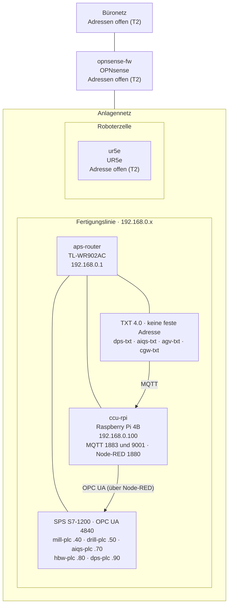

# Netzplan der Testfabrik

Stand: 21.11.2026 · Auftrag 106 · selbst verfasst.

Erdacht ist nur die Zusammenstellung: welche Anlagen in der Testfabrik stehen und dass eine Firewall das Anlagennetz vom Büronetz trennt. Jede Adresse, jeder Port und jedes Protokoll stammt aus einer Herstellerquelle und trägt eine Fundstelle. Was die Quellen nicht hergeben, steht als „offen“ da und wird nicht aufgefüllt.

## Quellen und Schreibweise der Fundstellen

| Kurzname | Quelle | Stand |
| --- | --- | --- |
| Handbuch | Bedienungsanleitung „Agile Production Simulation 24V“, Deutsch, Datei `dokumentation_aps_de-02-2025.pdf` | Version 4, Model revision 1.x, 02/2025, 38 Seiten |
| Repository 1 | `fischertechnik/Agile-Production-Simulation-24V` | Commit `b8082e16282a69f7d219a39d993bf7d34cb9d349` |
| Dev | `fischertechnik/Agile-Production-Simulation-24V-Dev` | Commit `24568073f7f70d0d31dcaa83bcfcd7b595baba1f` |

- „PDF-S.“ ist der Seitenindex der Datei (Zählung ab 1). Die aufgedruckte Seitenzahl ist um eins kleiner.
- „Zeile“ ist die Zeile der Rohdatei am genannten Commit.
- `flows.json` meint `Node-RED/flows.json` in Repository 1. Die Datei `nodeRed/flows.json` in Dev ist bytegleich.
- Adressen, Größen und Lizenzlage der Quellen stehen in `docs/testfabrik/quellen-fertigungslinie.md`.
- Die Quellen nennen an mehreren Stellen Standard-Zugangsdaten (Handbuch PDF-S. 30 und 38, Dev `docker-compose.yml` Zeilen 10–11). Sie werden hier nicht wiedergegeben.

Alle Fundstellen dieser Datei wurden am 21.11.2026 an den geladenen Dateien geprüft: das Handbuch seitenweise als Text und die Tabelle auf PDF-S. 38 sowie das Übersichtsbild auf PDF-S. 36 zusätzlich als Bild.

## Übersicht

Die Zeichnung zeigt die Zusammenstellung, keine Verkabelung. Wie die Firewall an das Netz der Fertigungslinie angeschlossen wird und ob die Roboterzelle im selben Netz liegt, ist offen (siehe „Offene Punkte“).

## Netze und Adressen

| Netz oder Gerät | Adresse | Fundstelle | Vermerk |
| --- | --- | --- | --- |
| Netz der Fertigungslinie | 192.168.0.x | Handbuch PDF-S. 30 (Adressbereich des Routers, darf nicht geändert werden); PDF-S. 38 (Tabelle) | Die Maske /24 wird nicht wörtlich genannt; sie ist aus der Schreibweise „192.168.0.x“ abgeleitet. |
| `aps-router` (TP-Link TL-WR902AC) | 192.168.0.1 | Handbuch PDF-S. 30; PDF-S. 38 (Tabelle, Zeile Router) | Das Modell steht auf PDF-S. 31 und 38. |
| `ccu-rpi` (Zentralsteuerung, Raspberry Pi 4B) | 192.168.0.100 | Handbuch PDF-S. 31 (feste Adresse); PDF-S. 38 (Tabelle, drei Zeilen CCU); PDF-S. 18; Repository 1 `README.md` Zeile 43; Dev `README.md` Zeile 117 | – |
| DHCP-Bereich des Routers | Beginn soll von .100 auf .101 gestellt werden | Handbuch PDF-S. 31 | Das Ende des Bereichs nennt das Handbuch nicht: offen. |
| `dps-txt`, `aiqs-txt`, `agv-txt`, `cgw-txt` (TXT 4.0) | keine feste Adresse (192.168.0.x) | Handbuch PDF-S. 38 (Tabelle, zwei Zeilen TXT 4.0) | Dass die Controller ihre Adresse per DHCP erhalten, sagt das Handbuch nicht wörtlich; es folgt aus „192.168.0.x“ und dem DHCP-Bereich auf PDF-S. 31. |
| `mill-plc` (Frässtation) | 192.168.0.40 | Handbuch PDF-S. 38 (Block MILL .40 bis .45); `flows.json` Zeile 1315 | Der Block ist für mehrere gleiche Module gedacht (PDF-S. 38, Spalte Bemerkung). Die Flows sprechen die erste Adresse an. |
| `drill-plc` (Bohrstation) | 192.168.0.50 | Handbuch PDF-S. 38 (Block DRILL .50 bis .55); `flows.json` Zeile 1342 | wie oben |
| `aiqs-plc` (Qualitätssicherung) | 192.168.0.70 | Handbuch PDF-S. 38 (Block AIQS .70 bis .75); `flows.json` Zeile 1396 | wie oben |
| `hbw-plc` (Hochregallager) | 192.168.0.80 | Handbuch PDF-S. 38 (Block HBW .80 bis .83); `flows.json` Zeile 1450 | wie oben |
| `dps-plc` (Wareneingang und -ausgang) | 192.168.0.90 | Handbuch PDF-S. 38 (DPS, eine Adresse); `flows.json` Zeile 1423 | – |
| Block .60 bis .65 | in der Testfabrik nicht belegt | Handbuch PDF-S. 38 (Block OVEN); `flows.json` Zeile 1369 | Gehört zum Zusatzmodul Brennofen, das nicht Teil der Testfabrik ist. |
| Roboterzelle (`ur5e`) | offen | keine Herstellerquelle für eine Adresse in dieser Zusammenstellung; Entscheidung zu Frage 2 in Auftrag 106 | Wird in T2 aus der echten Konfiguration von URSim übernommen. |
| Firewall (`opnsense-fw`), beide Seiten | offen | wie oben | Wird in T2 aus der `config.xml` der laufenden Firewall übernommen. |
| Büronetz | offen | wie oben | Wird in T2 mit der Firewall festgelegt. |

## Dienste und Ports

| Gerät | Dienst | Port | Fundstelle | Vermerk |
| --- | --- | --- | --- | --- |
| `aps-router` | Konfigurationsoberfläche (HTTP) | nicht genannt | Handbuch PDF-S. 30; PDF-S. 38 (Tabelle, Zeile Router) | Die Quelle nennt nur die Adresse mit `http://`. |
| `ccu-rpi` | SSH | 22 | Handbuch PDF-S. 38 (Tabelle, Zeile CCU, SSH) | – |
| `ccu-rpi` | MQTT-Broker (Mosquitto) | 1883 | Handbuch PDF-S. 38 (Tabelle, Zeile lokaler MQTT-Broker); Dev `mosquitto/config/mosquitto.conf` Zeile 1; Dev `docker-compose-prod.yml` Zeile 45; Dev `README.md` Zeile 182 | Der Broker verlangt eine Anmeldung (Dev `mosquitto.conf` Zeilen 5–6). |
| `ccu-rpi` | MQTT über WebSocket | 9001 | Dev `mosquitto/config/mosquitto.conf` Zeilen 8–9; Dev `docker-compose-prod.yml` Zeile 46; Dev `README.md` Zeile 183; Dev `docs/02-architecture.md` Zeile 38 | Steht nicht im Handbuch. |
| `ccu-rpi` | Node-RED | 1880 | Handbuch PDF-S. 38 (Tabelle, Zeile Node-RED); Repository 1 `README.md` Zeile 43; Dev `docker-compose-prod.yml` Zeile 56; Dev `README.md` Zeile 181 | Übersetzt zwischen OPC UA und MQTT (Handbuch PDF-S. 36). |
| `ccu-rpi` | Bedienoberfläche (HTTP) | 80 | Handbuch PDF-S. 18 (Adresse ohne Port); Dev `docker-compose-prod.yml` Zeile 33 | Das Handbuch nennt keinen Port; die 80 steht nur in der Compose-Datei. |
| TXT 4.0 (alle vier) | SSH | 22 | Handbuch PDF-S. 38 (Tabelle, Zeile TXT 4.0 Controller, SSH) | Muss am Controller erst eingeschaltet werden (dieselbe Zeile, Spalte Bemerkung). |
| TXT 4.0 (alle vier) | Web-Server | 80 | Handbuch PDF-S. 38 (Tabelle, Zeile TXT 4.0 Controller, WEB-Server) | Eingeschränkte Zugriffsrechte (dieselbe Zeile). |
| SPS (alle fünf) | OPC-UA-Server | 4840 | Handbuch PDF-S. 38 (Tabelle, Zeile SPS); `flows.json` Zeilen 1315, 1342, 1396, 1423, 1450 | Je SPS ein eigener Server (Handbuch PDF-S. 36). |
| `cgw-txt` | Verbindung zur fischertechnik Cloud | nicht genannt | Handbuch PDF-S. 37; Übersichtsbild PDF-S. 36 („MQTT-Bridge“, HTTPS) | Optional. Die Cloud selbst ist kein Gerät der Testfabrik. |

## Protokolle und Datenwege

| Weg | Protokoll | Fundstelle |
| --- | --- | --- |
| TXT 4.0 ↔ Zentralsteuerung | MQTT | Handbuch PDF-S. 36 (Text und Übersichtsbild) |
| Zentralsteuerung ↔ SPS | OPC UA; Node-RED auf der Zentralsteuerung übersetzt nach MQTT | Handbuch PDF-S. 36; Dev `docs/02-architecture.md` Zeilen 66–68 |
| Zentralsteuerung ↔ Transportfahrzeug | MQTT, Nachrichten nach VDA 5050 | Handbuch PDF-S. 37; PDF-S. 38 (Tabelle, Spalte Bemerkung) |
| Nachrichtenformat insgesamt | abgewandeltes VDA 5050 auf Grundlage von Version 2.0, auf alle Module ausgedehnt | Dev `docs/11-appendices.md` Zeilen 18 und 26; Dev `docs/01-introduction.md` Zeilen 46–52 |
| SPS mit zusätzlichem TXT 4.0 (AIQS, DPS) ↔ Node-RED | MQTT mit eigenen Topics unterhalb der Modulkennung | Dev `docs/04-opcua-relationship.md` Zeilen 315–325 |
| Geräte ↔ Router | Ethernet und WLAN | Handbuch PDF-S. 36 (Router für Kabel und Funk); PDF-S. 11 (Ethernetkabel zwischen den Grundplatten) |

## Widersprüche in den Quellen

Die Geräteliste und dieser Netzplan folgen dem Handbuch. Die abweichende Stelle wird jeweils genannt, nicht aufgelöst.

1. **Adressen der SPS.**
   - Fundstelle A: Handbuch PDF-S. 38 (Tabelle, Zeile SPS) nennt MILL .40–.45, DRILL .50–.55, OVEN .60–.65, AIQS .70–.75, HBW .80–.83, DPS .90. Dazu passen die OPC-UA-Endpunkte in `flows.json`, Zeilen 1315 (MILL .40), 1342 (DRILL .50), 1369 (OVEN .60), 1396 (AIQS .70), 1423 (DPS .90) und 1450 (HBW .80).
   - Fundstelle B: Dev `docker-compose.yml` Zeilen 53–58 setzt für die Entwicklungsumgebung MILL .135, DRILL .130, OVEN .125, AIQS .120, DPS .150, HBW .140.
   - Einordnung: Die Compose-Datei für den Betrieb auf der Zentralsteuerung (Dev `docker-compose-prod.yml` Zeilen 47–56) setzt diese Variablen nicht. Warum die Entwicklungsumgebung andere Adressen nennt, sagen die Quellen nicht.
2. **CPU der Modulsteuerungen.**
   - Fundstelle A: Handbuch PDF-S. 34 (gedr. S. 33) nennt im selben Satz beide Bezeichnungen: „SIMATIC S7-1200 mit CPU1512SP“.
   - Fundstelle B: Handbuch PDF-S. 36 (gedr. S. 35) und die Tabelle auf PDF-S. 38 (gedr. S. 37) nennen nur die S7-1200. Auch der Ordner der Projektarchive in Repository 1 heißt `PLC-programs/S7_1200_TIAv18/`.
   - Einordnung: Welche CPU tatsächlich verbaut ist, lässt sich ohne TIA Portal an den Projektarchiven nicht prüfen. Die Geräteliste führt deshalb beide Angaben im Feld `model`.

## Weitere Beobachtungen

- Das Handbuch spricht auf PDF-S. 3 und 36 von sechs Modulen und zählt die Ladestation dazu. Das Übersichtsbild auf PDF-S. 36 zeigt Steuergeräte für fünf Module und das Transportfahrzeug, für die Ladestation keines.
- Der Port 9001 steht nur in den Dateien von Dev, nicht im Handbuch.
- Das Handbuch nennt vier TXT 4.0 (PDF-S. 15). Das Übersichtsbild auf PDF-S. 36 zeigt ebenfalls vier: einen am Transportfahrzeug, zwei am Wareneingang und -ausgang, einen an der Qualitätssicherung.

## Offene Punkte

1. Adressen der Roboterzelle, der Firewall und des Büronetzes: kommen in T2 aus den echten Konfigurationen.
2. Anschluss der Firewall an das Netz der Fertigungslinie: Laut Handbuch PDF-S. 30 verbindet sich der Router der Fertigungslinie nur per WLAN mit einem übergeordneten Netz, nicht per Kabel. Wie die Testfabrik den Übergang abbildet, ist in T2 festzulegen.
3. Ob die Roboterzelle im Netz 192.168.0.x liegt oder ein eigenes Segment bekommt: in T2 festzulegen.
4. Ende des DHCP-Bereichs und tatsächliche Adressen der vier TXT 4.0: in den Quellen nicht genannt.
5. Genaue CPU und Firmware der SPS, Firmware der TXT 4.0, Betriebssystem der Zentralsteuerung, Hardware-Version und Firmware des Routers: in den gelesenen Quellen nicht genannt.
